<div align="center">

<picture>
  <source media="(prefers-color-scheme: dark)" srcset="docs/assets/logo-dark.svg">
  
</picture>

<br><br>


<br>

**Type what you hear. It measures, decides and makes the change live in your REAPER session.**
<br>
You chat in plain English in Claude Code, by keyboard (or dictation, if you like). No menus to learn, no exporting, no code.

<br>

[](https://www.reaper.fm/)
[](https://claude.com/claude-code)
[](https://lorekit.io)
[](#-install-in-3-steps)
[](LICENSE)

[**Install in 3 steps**](#-install-in-3-steps) · [See it work](#-just-type-what-you-hear) · [What you get](#-why-producers-use-it) · [Watch it work](#-see-what-your-agent-is-doing) · [Extensions](#-extensions-teach-it-your-plugin) · [Clients & models](#-clients-and-models) · [FAQ](#-faq)

</div>

---

## 💬 Just type what you hear

You know what's wrong with your mix. You just don't want to spend an hour in
plugin windows fixing it. Type it into Claude Code the way you'd say it to an
engineer. It's a text chat, so no microphone or voice setup is needed (dictate
with your OS if you prefer, it's the same thing to the agent):

> 🎧 *"Please gain stage my tracks."*
>
> 🎸 *"The chorus needs more energy. Make the vocals cut through."*
>
> 🔊 *"I hear some low-end rumble. Can you fix that?"*
>
> 🔥 *"Roast my mix. What could be better?"*
>
> 💿 *"Master this for Spotify."*

Here's what happens next:


It isn't a preset and it isn't a guess. Before it touches anything it **measures your
actual tracks** (loudness, spectrum, stereo width, dynamics). It makes the change with
**the plugins you own**, then **measures again** to check it worked.

---

## ✨ Why producers use it

<table>
<tr>
<td width="33%" valign="top">

### 👂 It measures, then mixes
It reads LUFS, true peak, the frequency spectrum, stereo correlation and crest factor
on every track before it decides anything, and again after. You get numbers, not vibes.

</td>
<td width="33%" valign="top">

### 🎛️ It uses *your* plugins
It finds your installed FX and reaches for the best one you have: **FabFilter Pro-Q 3**
if it's there, **ReaEQ** if not. Anything it doesn't know yet, it learns.

</td>
<td width="33%" valign="top">

### 🛟 You can't lose your mix
It saves a snapshot **before and after** every change, so you can A/B them with one
click. Each edit is a single REAPER undo step.

</td>
</tr>
<tr>
<td valign="top">

### 🎸 It knows the genre
Rock, pop, hip-hop, electronic, metal, orchestral. It adjusts loudness targets, low-end
handling and dynamics to the style. Just tell it what you're making.

</td>
<td valign="top">

### 🧠 It remembers
With **[LoreKit](#-lorekit-the-knowledge-core)** as its memory, it keeps what it learns
about your plugins and your taste, so a correction sticks. It also draws on a shared
plugin library that grows every time someone
**[contributes](knowledge/contributions/README.md)**, you included.

</td>
<td valign="top">

### ⚡ It works live, in real time
It talks straight to your open session, about 50–150 ms per action. You don't bounce
or upload anything, and you hear each change as it happens.

</td>
</tr>
</table>

---

## 🔍 How it works

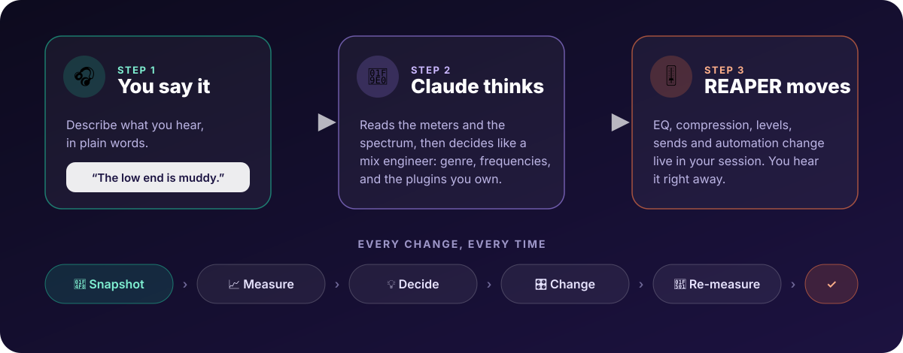

**You stay in charge.** Ask it to explain before it acts, undo anything, or use
`/critique` for advice without a single change to your project.

---

## 🧠 LoreKit: the knowledge core

A mix engineer's value is what they've learned. reaper-mcp keeps all of that in
**[LoreKit](https://lorekit.io)**, a free, open-source memory store for AI agents. It's
what turns a remote control into an engineer that gets better every session.


- 🎛️ **One record per plugin.** What it is, what each knob does, the settings that
  worked and the gotchas. Ask for a plugin it has never seen and it **researches it,
  inspects it live and writes the record first**, then uses it. You can also teach it
  one with `/learn-plugin`.
- 📝 **Lessons from your corrections.** Revert a change, or have a re-measure come back
  worse, and it saves a lesson right then. A lesson that keeps coming up becomes one of
  the mixer's permanent rules, so it stops making that mistake.
- 🧩 **Built-in knowledge plus your own.** It ships with a curated, read-only set of
  plugin records and lessons, and everything it learns from *you* goes into your own
  layer on top. When the two disagree, yours wins, so your taste never gets
  overwritten. The built-in set comes with the server, read-only, and needs no
  LoreKit account. Connect your own LoreKit to start your layer.
- 📚 **A built-in plugin library.** FabFilter, Soundtoys, Valhalla, iZotope, Melodyne, the
  REAPER stock plugins and more: see the **[built-in plugin list](docs/PLUGINS.md)**, and how
  to add yours.
- 🤝 **Share what you taught it.** Press **Contribute** in the bridge page's Plugins tab
  and your plugin records become a pull request. Once the maintainer approves it, they're
  built in for every reaper-mcp user and added to the
  [plugin list](docs/PLUGINS.md) ([how it works](knowledge/contributions/README.md)).
  Regular contributors can publish straight to built-in, no pull request: ask on
  [Discord](https://discord.gg/Eg8tznuXp4).
- 🌍 **It follows you.** The memory isn't tied to one project folder. Whatever song
  you open, it brings what it knows.
- 🔒 **Audio knowledge only.** It never stores client names, song titles or license keys.

> **No LoreKit? It still mixes.** Everything works without it. It just starts from
> scratch every session instead of getting smarter. Genre rules, step-by-step workflows
> and reference sheets (frequencies, compression, loudness) ship with the repo either way.

---

## 🚀 Install in 3 steps

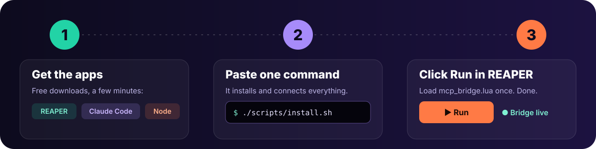

### 1 · Get the apps

| | | |
|---|---|---|
| 🎚️ **REAPER** | your DAW (v6+, v7 recommended) | [reaper.fm](https://www.reaper.fm/) |
| 🤖 **Claude Code** | the AI you talk to | [claude.com/claude-code](https://claude.com/claude-code) |
| 🟢 **Node.js 20+** | runs the connector behind the scenes | [nodejs.org](https://nodejs.org/) |
| 🧠 **LoreKit** *(recommended)* | the memory, so it learns | [lorekit.io](https://lorekit.io) |
| ➕ **SWS Extensions** *(optional)* | extra REAPER powers | [sws-extension.org](https://www.sws-extension.org/) |

### 2 · Paste one command

Open **Terminal** (macOS/Linux) or **Git Bash** (Windows), then paste:

```bash
git clone https://github.com/mthines/reaper-mcp.git && cd reaper-mcp && ./scripts/install.sh
```

That's it. It installs everything, puts the connector into REAPER and sets up Claude Code.
Nothing else to install. When a new version is out, the bridge window in REAPER shows an
**Update** button that does the rest. From a terminal it's `./scripts/update.sh`.

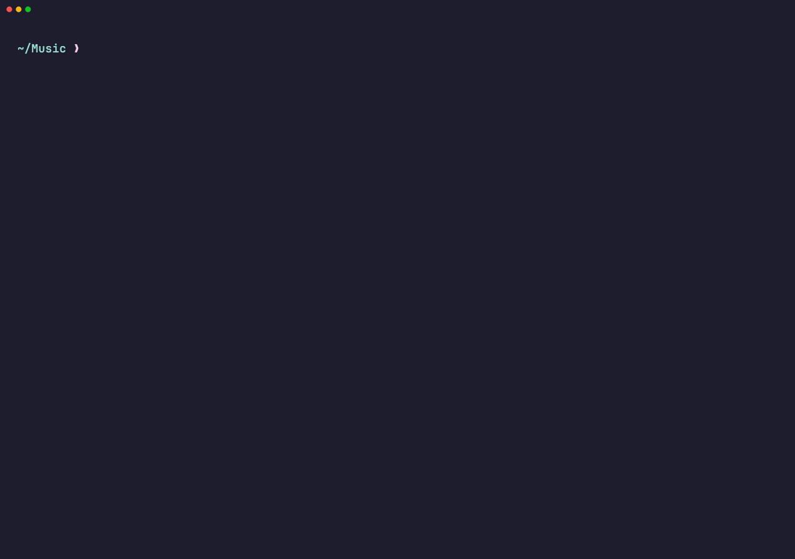

<sub>A real run, recorded by our install test (<code>scripts/test-install.sh</code>). The very first
download takes about a minute.</sub>

<details>
<summary><b>Prefer ReaPack for the REAPER side?</b></summary>

In REAPER: **Extensions → ReaPack → Import repositories…**, paste
`https://github.com/mthines/reaper-mcp/releases/latest/download/index.xml`, then **Browse packages**,
search `reaper-mcp` and install the three packages (bridge, meters, status page). ReaPack then offers
updates like any other package. The server and Claude Code side is still
`npm install -g @mthines/reaper-mcp && reaper-mcp init` (ReaPack can't edit REAPER's startup script or
turn on its web interface, so run `reaper-mcp setup` once too if you want the bridge to start with REAPER).

</details>

### 3 · Start REAPER

Start REAPER, or restart it if it was open: the installer added the bridge to REAPER's
startup script, so it starts with REAPER. A small status window opens, showing the bridge
is live. 🟢 Don't want it starting on its own? Turn off **Settings → Start with REAPER** in
that window.

Rather not restart? **Actions → Show action list → Load ReaScript…**, pick **`mcp_bridge.lua`**
and click **Run**. Running it again stops the bridge.

**Now open Claude Code in any folder (your song folder is perfect) and start mixing:**

```
/mixer Please gain stage my tracks
```

<details>
<summary><b>What did the installer just do?</b></summary>

<br>

1. Installed dependencies and built the server, using the package tools that come
   with Node.js.
2. Copied the bridge script, A/B snapshot scripts and meters (LUFS, spectrum,
   correlation, crest factor) into REAPER, and turned on REAPER's web interface for
   the status window.
3. Linked the mix skills and genre/workflow knowledge into Claude Code.
4. Registered REAPER with Claude Code for your user, so it works from any folder.
5. Pre-approved the REAPER tools in Claude Code, so it doesn't ask permission for every knob.

Check everything any time with `npm run doctor` from the `reaper-mcp` folder. The full
breakdown is in [docs/REFERENCE.md](docs/REFERENCE.md#installation).

</details>

<details>
<summary><b>Something not working?</b></summary>

<br>

- **Run `npm run doctor`** in the `reaper-mcp` folder. It checks the bridge, whether it
  starts with REAPER, the knowledge and the Claude Code config.
- **Is the bridge running?** The status window shows 🟢 when it is. If not, run
  `mcp_bridge.lua` again from REAPER's action list.
- **Claude Code doesn't see REAPER?** Install Claude Code first, then run
  `./scripts/install.sh` again. It registers REAPER with Claude Code.
- **Newer tools time out after an update?** Run `./scripts/install.sh` again, then click
  **Restart** in the status window's Settings, or run `mcp_bridge.lua` twice (once to stop it,
  once to start the new copy).

</details>

---

## 🎚️ Meet your engineers

Nine skills, each tuned for a job. Type the slash command, or just describe what you
want and the right one starts (all but `/teach`, which starts only when you type it).

| | Skill | What it does | Try |
|---|---|---|---|
| 🎚️ | **`/mixer`** | Does the mixing: gain staging, vocal chains, drum bus, low end, stereo image | `/mixer Build a vocal chain on track 3` |
| 🔥 | **`/critique`** | "Roast my mix." A measured report of what to fix. **Changes nothing.** | `/critique What's holding this mix back?` |
| ✂️ | **`/editing`** | Edits notes, arrangement and timing, and compares two versions of a part in lanes | `/editing Make the chorus half-time` |
| 💿 | **`/mastering`** | A mastering chain on the mix bus, aimed at a platform's loudness | `/mastering Master this for Spotify` |
| 🧑‍🏫 | **`/teach`** | Beginner mode, for anyone new to REAPER: one change at a time, saying what it changes and why, the REAPER concept behind it, how to do it yourself with your own shortcuts, and a link to the before/after on the bridge page. Honest that its mixing advice comes from a model. Starts only when you type `/teach` | `/teach Help me balance my drums` |
| 🎓 | **`/learn-plugin`** | Researches a plugin you own, tests it live and saves it to LoreKit, asking you only what it can't work out | `/learn-plugin JST Gain Reduction Deluxe` |
| 🛠️ | **`/make-plugin`** | Makes you a plugin for a need no plugin covers. A simple core view (with live graphs when they help: a frequency graph (`ui_freqgraph`) with draggable Hz band handles, gain-reduction bars, a transfer curve, a MIDI keyboard), the rest in an Advanced drawer, a few presets that show how to use it, proven by measurement. It's just a plugin afterwards, no bridge or server needed | `/make-plugin randomly mutate my samples and add reverb` |
| 🧩 | **`/new-extension`** | Builds or updates an [extension](#-extensions-teach-it-your-plugin) that edits a plugin's internals (wavetables, mod matrix, patch state) and proves it live on a scratch track | `/new-extension Serum` |
| 🗂️ | **`/mix-memory`** | Shows what it remembers, and tidies it up | `/mix-memory What do you know about Pro-C 2?` |

---

## 🧰 What it can control

Almost everything in your session. That's **130+ tools**, so it can do the job
instead of just giving advice:

| | | |
|---|---|---|
| 🎚️ **Tracks & mixer**: volume, pan, mute/solo, folders, colors, groups & VCAs | 🎛️ **FX & plugins**: add, tweak, bypass, presets, FX chains, track templates | 📈 **Metering**: LUFS, true peak, spectrum, stereo correlation, crest factor |
| 🔀 **Routing**: sends, buses, sidechains, hardware outputs | 🎹 **MIDI**: write, edit and analyze notes & CC, live MIDI out | ✂️ **Editing**: split, trim, move, fades, takes, stretch markers |
| 📍 **Arrangement**: markers, regions, tempo map | 〰️ **Automation**: envelopes, points and pooled automation items | 💾 **Project**: save, render, undo/redo, snapshots, REAPER actions |

👉 The main tools by area: **[docs/TOOLS.md](docs/TOOLS.md)**

### 🎸 Genre-aware out of the box

| Genre | Loudness target | What it leans into |
|---|---|---|
| 🎸 Rock | −11 to −9 LUFS | Parallel drum compression, hard-panned guitars |
| 🎤 Pop | −14 to −10 LUFS | Vocal-forward, two-stage compression, bus glue |
| 🎧 Hip-Hop | −10 to −7 LUFS | 808 saturation, aggressive vocal comp, mono sub |
| 🎛️ Electronic | −10 to −6 LUFS | Sidechain pump, mono sub, stereo width |
| 🎻 Orchestral | −23 to −16 LUFS | Preserved dynamics, hall reverb staging |
| 🤘 Metal | −11 to −8 LUFS | Scooped guitars, tight drums, four-guitar wall |

---

## 🛠️ Make your own plugin

Nothing on the shelf does what you want? Ask for it. **`/make-plugin`** writes you a real
REAPER plugin, loads it, listens to it and fixes it until it does what you asked. Afterwards
it's **just a plugin**: it keeps working with no bridge, no server and no Claude.

> 🎲 *"/make-plugin randomly mutate my samples and add reverb"*
>
> 🔥 *"/make-plugin a tape saturator, warm by default, with a drive and a tone"*
>
> ↔️ *"/make-plugin keep everything under 120 Hz in mono and widen the rest"*

<p>
  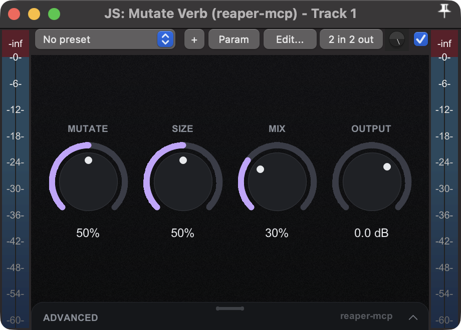
  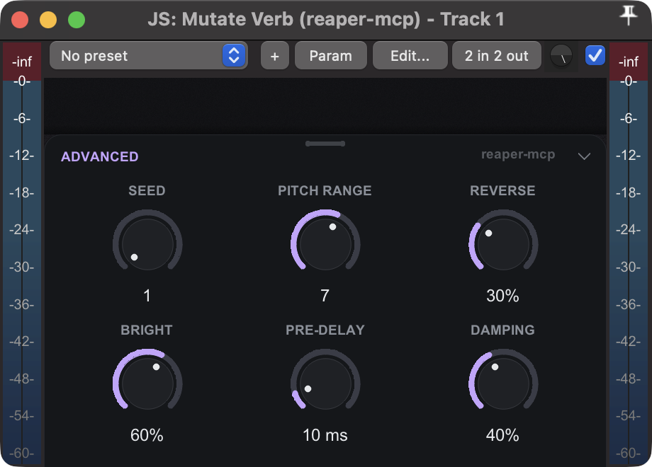
</p>

- 🎛️ **A simple core, the rest on demand.** A few big knobs up front; everything else lives in an **Advanced** drawer that overlays the view instead of squeezing it.
- 🎨 **Its own look.** Every plugin gets its own accent colour, so a growing set is easy to tell apart. Ask for another colour and it keeps it.
- ⌨️ **Type a value.** Double-click a knob to type an exact number; Cmd/Ctrl-click resets it.
- 🎚️ **Presets that teach.** It ships a few suggested presets, so you see how the plugin is meant to be used.
- 📏 **Proven by measurement.** It renders with the plugin on and off and checks the audio changed, because a plugin that fails to compile still loads in REAPER.
- 🗂️ **Easy to find.** Plugins land in your FX list as `… (reaper-mcp)`, and old versions are kept.

📖 How it works, the toolkit, the examples and the limits: **[docs/PLUGIN-AUTHORING.md](docs/PLUGIN-AUTHORING.md)**

> 🚧 **Coming next:** graphs. Frequency displays with band selection (for an EQ or a multiband
> compressor), spectrum and gain-reduction meters, and a MIDI keyboard.

---

## 🧩 Extensions: teach it your plugin

Out of the box it controls any plugin through its knobs. But some of what makes a sound
isn't a knob: a synth's **wavetables**, its **modulation matrix**, a guitar rig's **preset
file**. **Extensions** reach that. They're small add-ons you switch on, and you can have
Claude build one for the plugin *you* use.

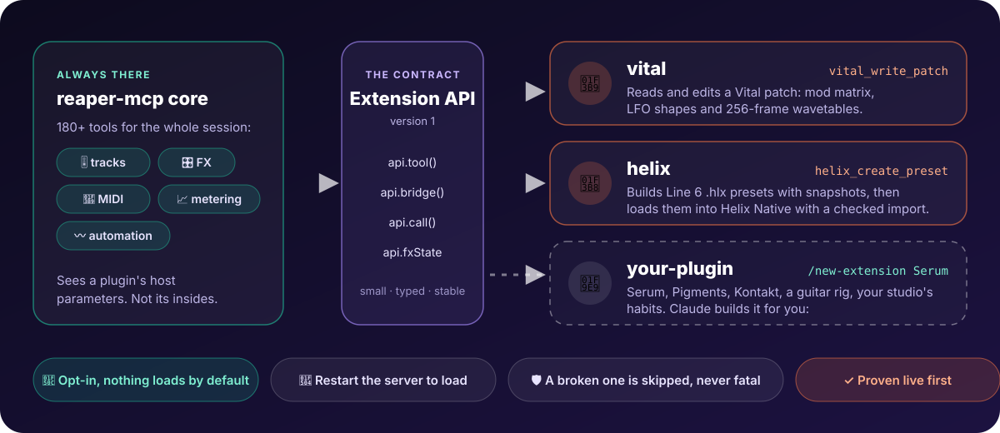

> 🎹 *"On the Vital on track 2, route LFO 2 to the filter cutoff at 40% and make it a slow triangle."*
>
> 🎸 *"Build me a djent rhythm tone in Helix with a clean, a crunch and a lead snapshot."*
>
> 🌊 *"Give this synth a wavetable that morphs from a sine to a bright saw over 64 frames."*

| | Extension | What Claude can do with it |
|---|---|---|
| 🎹 | **`vital`** | Read a Vital patch and edit its settings, **mod matrix** and **LFO shapes**; build **wavetables** (1-256 frames) from classic shapes or harmonic recipes |
| 🎸 | **`helix`** | Build and edit Line 6 **Helix presets** with up to 8 snapshots, check them against real models, and load them into Helix Native, **backed up and rolled back** if anything else changed |
| 🎼 | **`composition`** | Write MIDI from notation: **chord progressions** (`"Cm7, Fm7, Bb7, Eb"`) and step-sequencer **drum patterns** with GM and GGD Invasion maps |
| 🧩 | **yours** | `/new-extension Serum`: Claude researches the plugin's format, probes it on a scratch track, writes the tools **with tests** and proves they change the sound |

**Switch one on**, then restart Claude Code:

```bash
reaper-mcp extension add vital      # or: helix, composition
reaper-mcp extension list           # what's installed, and why one can't load
```

- 🔌 **Opt-in.** Nothing loads unless you add it. `reaper-mcp extension remove vital` takes it out.
- 🛟 **Same safety as the rest.** Every edit is one undo step, and write tools can preview with a dry run.
- 🛡️ **A broken extension is skipped**, never a crash, and `reaper-mcp doctor` tells you why.
- 🧪 **Proven live.** `/new-extension` doesn't finish until the edit shows up in the plugin *and* in the audio.

📖 Full guide (the API, Lua handlers, testing, sharing, troubleshooting): **[docs/EXTENSIONS.md](docs/EXTENSIONS.md)**

---

## 🛟 Safe by design

- 📸 **Snapshots around every mix task.** The mix skills save one before and after; A/B them in the
  bridge window, or bind `mcp_snapshot_next` / `_prev` / `_quick_save` to keys (setup adds them to the Action List).
- ↩️ **One change, one undo.** Each edit is labelled `MCP: …` in REAPER's undo history.
- 🚫 **No surprise pop-ups.** It won't run anything that opens a dialog unless you allow
  it, and it never closes your project or quits REAPER.
- 👀 **Advice-only mode.** `/critique` never changes your project. The bridge window
  also has a read-only switch and a pause button.
- 📊 **Bridge status window.** See every action as it happens, with timing and errors,
  in a small window next to REAPER ([see what it shows](#-see-what-your-agent-is-doing)).

📖 What it can and can't do to a session, and what isn't covered: **[docs/SAFETY.md](docs/SAFETY.md)**.

---

## 🔭 See what your agent is doing

You shouldn't have to take its word for it. The **bridge window** opens next to REAPER and
logs every move the agent makes, as it happens: what it did, how long it took and anything
that went wrong. With several Claude sessions connected, you can see which one did what.

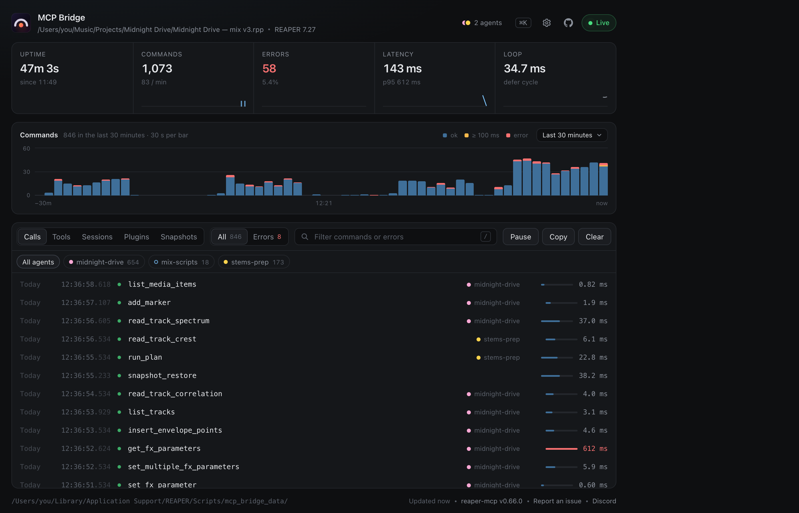

<sub>Demo data. Add <code>?demo</code> to the window's address to explore it without REAPER.</sub>

### Click any call to see what it did

Every call opens a drawer in plain words (*"midnight-drive wrote new points into the Volume
automation on track 5"*) with a picture of the change: **before → after** for edits, a
readout against your target for measurements.

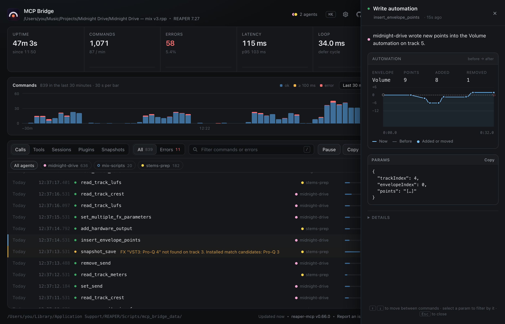

### 📈 What it measured

<table>
<tr>
<td width="50%" valign="top">

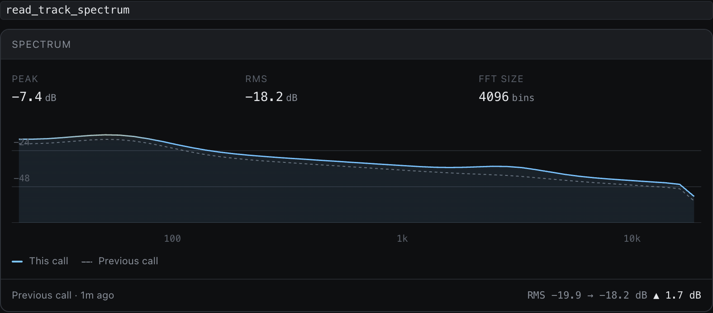

**Spectrum**<br><sub>Where the energy sits, band by band, judged by perceived loudness. Hot bands turn amber.</sub>

</td>
<td width="50%" valign="top">

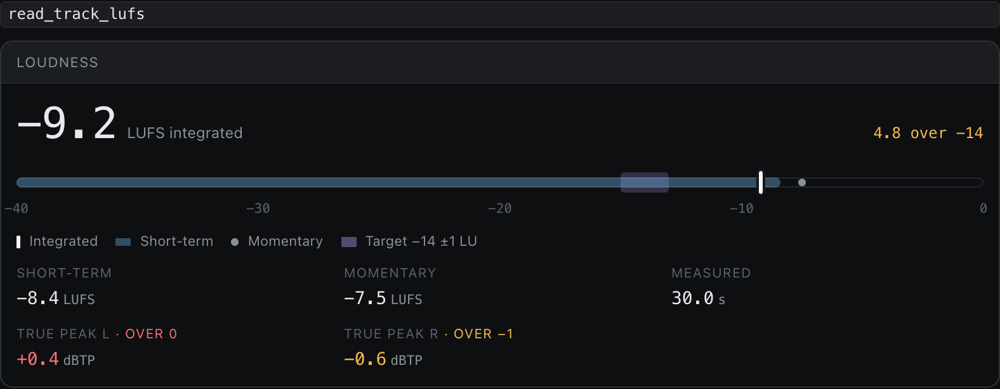

**Loudness**<br><sub>LUFS against your target, true peak, and how it moved since the last measurement.</sub>

</td>
</tr>
<tr>
<td width="50%" valign="top">

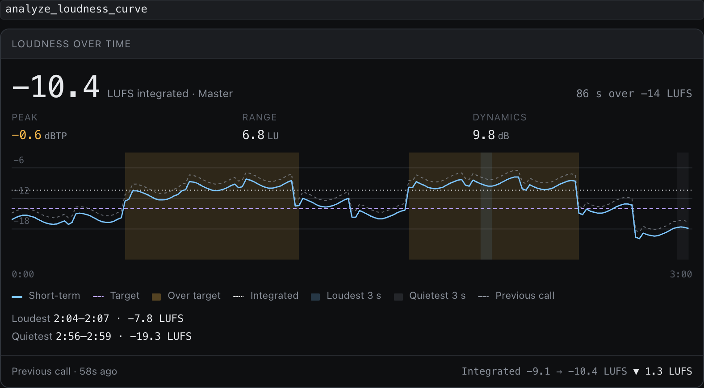

**Loudness over time**<br><sub>The whole song's loudness, with the stretches that run over target shaded.</sub>

</td>
<td width="50%" valign="top">

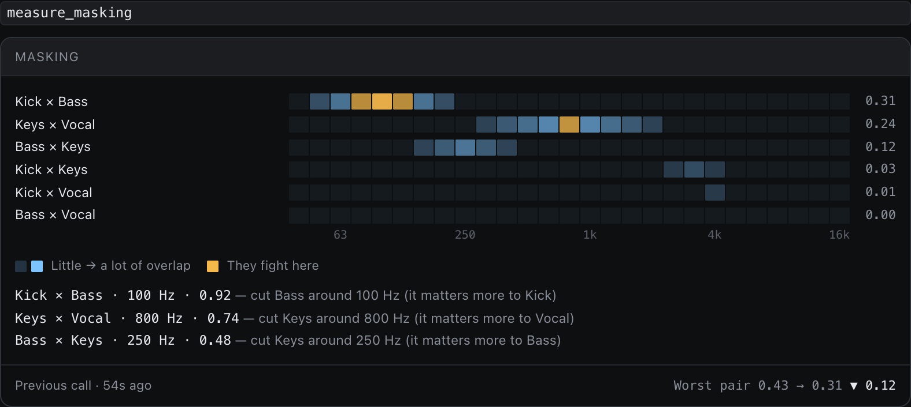

**Masking**<br><sub>Which tracks fight, at which frequency, and which one should give way.</sub>

</td>
</tr>
<tr>
<td width="50%" valign="top">

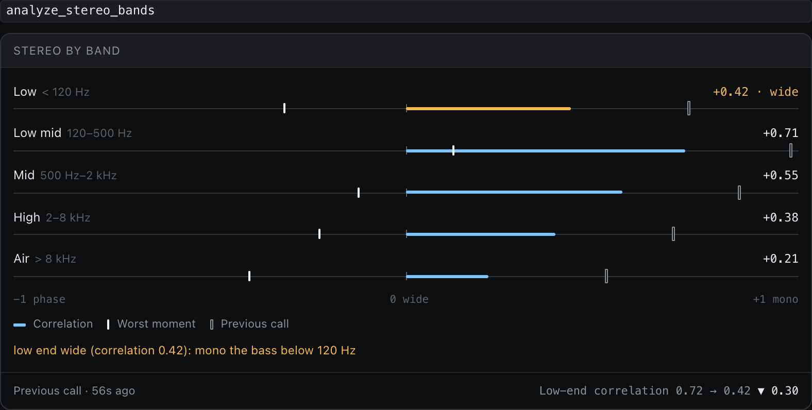

**Stereo, per band**<br><sub>Phase correlation per band. Catches a wide or out-of-phase low end before it hurts.</sub>

</td>
<td width="50%" valign="top">

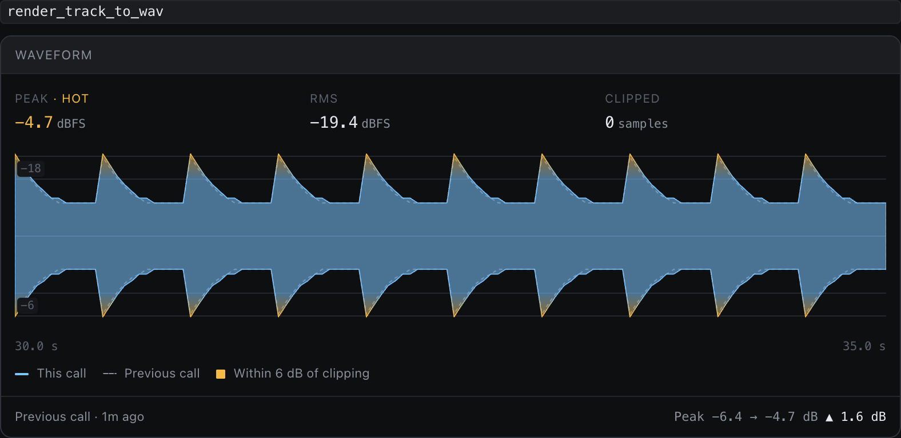

**Waveform**<br><sub>What a rendered track really looks like, with clipping counted.</sub>

</td>
</tr>
</table>

### 🎛️ What it changed

Every edit is drawn **before → after**: new in blue, old dashed or ghosted, removed struck through.

<table>
<tr>
<td width="50%" valign="top">

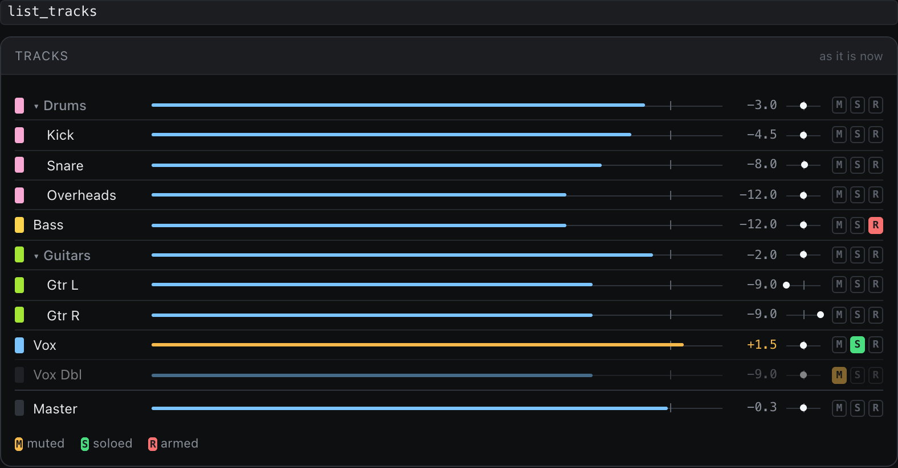

**Mixer**<br><sub>The session as a mixer: folders, levels, pans, mute, solo and arm.</sub>

</td>
<td width="50%" valign="top">

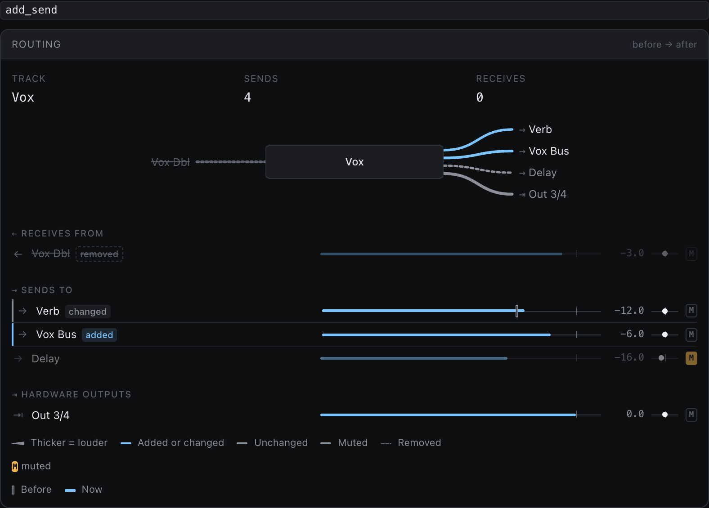

**Routing**<br><sub>Sends, receives and outputs as signal flow. Thicker wire means louder.</sub>

</td>
</tr>
<tr>
<td width="50%" valign="top">

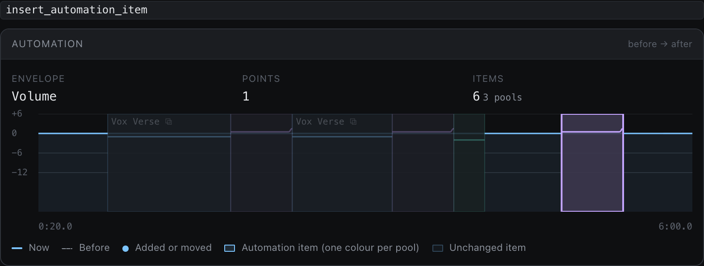

**Automation**<br><sub>Envelope points and pooled automation items, before and after.</sub>

</td>
<td width="50%" valign="top">

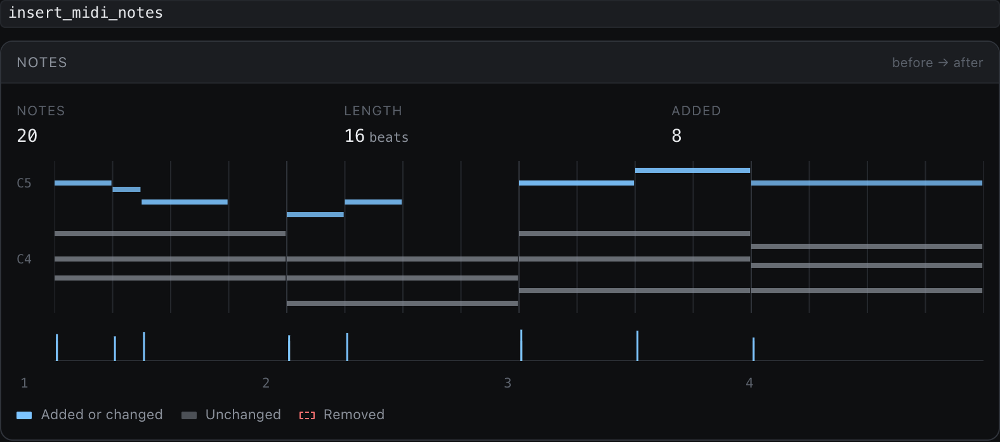

**Piano roll**<br><sub>MIDI edits as a piano roll: added, kept and removed notes, with velocity.</sub>

</td>
</tr>
<tr>
<td width="50%" valign="top">

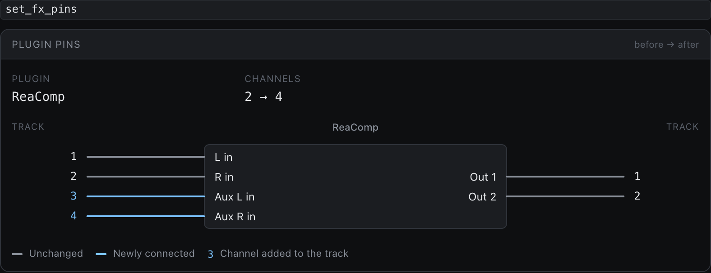

**Plugin pins**<br><sub>Which track channels feed which plugin pins. Here, a sidechain just got wired in.</sub>

</td>
<td width="50%" valign="top">

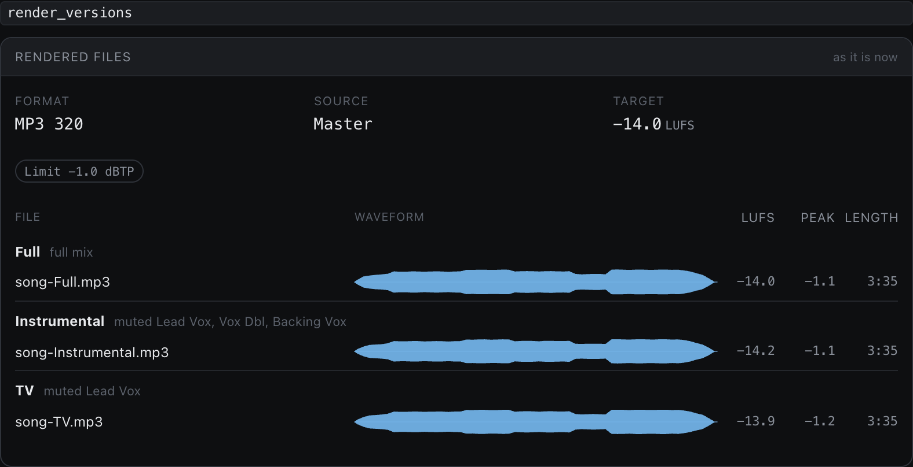

**Renders**<br><sub>Every rendered file with its LUFS, peak and length against your target.</sub>

</td>
</tr>
</table>

<sub>Illustrative data, drawn by the same components the bridge window uses. There's a view for nearly every tool
that reads or writes your session.</sub>

---

## 🤖 Clients and models

reaper-mcp is an [MCP](https://modelcontextprotocol.io) server: a set of REAPER tools any MCP client that can start a local (stdio) server can call.
It has no model of its own, so the AI is whichever one your client runs.

**Tested clients**

| Client | Status |
|---|---|
| **Claude Code** | Tested daily. The installer sets it up, and the `/mixer`, `/critique`, `/mastering` and `/editing` skills are written for it. |
| **Other MCP clients** (Claude Desktop, Cursor, VS Code, …) | Not tested. The tools work from any client that runs a local stdio server: [config](docs/REFERENCE.md#other-mcp-clients). The skills only load where the client reads `SKILL.md` files. |

**Typed or voice?**
Typed. reaper-mcp never listens to a microphone for instructions: it gets text from your client.
Speaking works if your client or your OS dictation turns it into text first.

**Local models**
They work, if your client can run one and the model is good at tool calling.
Nobody has tested a local model end to end yet, so treat it as an experiment. What to expect:

- **Context:** the 189 tool schemas take about **51k tokens** before you type a word.
  You need a context window of at least 64k, and 128k is more realistic for a session.
- **Tool calling:** the mix skills chain 10 to 30 tool calls per task with exact track and FX indexes.
  A model that invents parameters or drops JSON fields fails there.
  Pick an instruction-tuned model your client lists with native tool calling, the biggest your machine runs.
- **Speed:** each turn sends those 51k tokens again, so on a laptop GPU expect slow turns.
- **A smaller tool set:** set `REAPER_MCP_PROFILE` in your client's server `env` to load only what you need. `mixing` (122 tools),
  `music` (127), `analysis` (79) or `minimal` (56), all under the 128 tools some clients allow; unset or `full` loads all 189.
  Combine them with category names or an extension (`mixing,midi`, `mixing,composition`); a combination can go over 128, so check the count the server logs at start.
  `list_tool_categories` then lists only what is loaded.

Tried one? [Tell us how it went](https://github.com/mthines/reaper-mcp/issues/72), and we'll list what works here.

**What is it trained on?**
Nothing. There is no reaper-mcp model and nothing is trained on your sessions.
The skills and [`knowledge/`](knowledge/) are plain text: opinions and checklists your model reads, which you can edit or skip.
Where your data goes:

- **Your model** sees what the tools return: track names, FX settings, meter readings, file paths,
  and MIDI notes when a tool reads them.
  Audio stays on your machine; analysis that needs audio runs in the optional local Python sidecar ([`reaper-mcp setup-sidecar`](docs/REFERENCE.md#cli-commands)).
- **LoreKit, built-in layer:** the skills look up shared plugin knowledge with a public read-only key,
  so search terms such as plugin names reach LoreKit even if you never connect it.
- **LoreKit, your layer** (only if you connect it) stores what the skills learn about plugins and your preferences.
- **Usage telemetry** (on by default, [easy to turn off](#-privacy--telemetry)) sends tool names, the kind of
  error and timings, never content. The bridge page has its own switch: [TELEMETRY.md](TELEMETRY.md#the-bridge-page).

---

## 🔒 Privacy & telemetry

Hi 👋 reaper-mcp isn't a company — it's just me. I'm a developer who loves making music,
and I build this in my spare time because it's the tool I wanted for my own sessions 🎛️

The catch: I can only test it on my own setup. To make sure it also works on yours —
other REAPER versions, other plugins, other OSes — reaper-mcp sends **pseudonymous usage
data** by default: which tools run, whether they fail, and how long they take. A random
install id groups one machine's calls together. It isn't tied to your name, account or
computer.

**Never sent:** your projects, track or plugin names, settings, file paths, error
messages, audio or MIDI. I respect your privacy 🙏

You're in control: setup asks before anything is sent, and `reaper-mcp telemetry off`
turns it off for good — no hard feelings. Everything that's collected, and where it
goes, is in [TELEMETRY.md](TELEMETRY.md).

---

## ❓ FAQ

<details>
<summary><b>Do I need to know how to code?</b></summary>
<br>
No. You paste one command to install. After that you type in plain words, the way you
would say it to an engineer.
</details>

<details>
<summary><b>Is this voice control?</b></summary>
<br>
No. You type to it in Claude Code, like any chat. "Talking" means plain language, not
a microphone. Nothing listens to you. If you'd rather speak, use your OS dictation or a
voice-to-text tool; the agent just sees the text.
</details>

<details>
<summary><b>Does it work with other AI apps or local models?</b></summary>
<br>
The tools work from any MCP client that can start a local (stdio) server, and with a local model if it handles tool calling well and has a big enough
context window. Only Claude Code is tested. See <a href="#-clients-and-models">Clients and models</a>.
</details>

<details>
<summary><b>What is it trained on?</b></summary>
<br>
Nothing. It brings no model of its own and trains nothing; you bring the model. The skills are optional opinions in
plain text. <a href="#-clients-and-models">Where your data goes</a>.
</details>

<details>
<summary><b>Will it replace me?</b></summary>
<br>
No. It handles the tedious, measurable parts: gain staging, cleaning up clashing
frequencies, hitting loudness targets. Taste and the final call stay with you, and it
explains its reasoning so you can push back.
</details>

<details>
<summary><b>Can it wreck my project?</b></summary>
<br>
Every edit is a single undo step, and the mix skills snapshot before and after a task. Use
<code>/critique</code> or read-only mode if you only want advice. Saving a copy of your project
before a big session never hurts. <a href="docs/SAFETY.md">What is and isn't guarded</a>.
</details>

<details>
<summary><b>Which plugins does it work with?</b></summary>
<br>
Any plugin REAPER can load (VST, VST3, AU, CLAP, JS). It finds what you have installed
and reaches for the best tool for each job. The ones it already knows are in the
<a href="docs/PLUGINS.md">built-in plugin list</a>. When it meets a plugin it doesn't know, it
researches it, inspects its controls live and saves what it learns to LoreKit. You can
also teach it one up front with <code>/learn-plugin</code>.
</details>

<details>
<summary><b>It doesn't support my plugin's patches, wavetables or presets. Now what?</b></summary>
<br>
Host parameters already work for any plugin. For anything deeper, build an
<a href="#-extensions-teach-it-your-plugin">extension</a>: run <code>/new-extension YourPlugin</code> and
Claude researches the format, writes the tools and tests, and proves them on a scratch track. Today there are
extensions for Vital and Line 6 Helix.
</details>

<details>
<summary><b>What does it cost?</b></summary>
<br>
reaper-mcp is free and open source (MIT), and so is LoreKit. You need REAPER and a
Claude plan that includes Claude Code.
</details>

<details>
<summary><b>Do my audio files get uploaded?</b></summary>
<br>
No. It reads meter values and settings from your running session, not your audio files.
</details>

---

## 🛠️ For developers

- 📖 **[docs/REFERENCE.md](docs/REFERENCE.md)**: architecture, install internals, CLI,
  environment variables, telemetry, project structure
- 🧰 **[docs/TOOLS.md](docs/TOOLS.md)**: the main tools by area
- 🧩 **[docs/EXTENSIONS.md](docs/EXTENSIONS.md)**: write, test and share an extension (the API, Lua handlers, Vital and Helix)
- 🧑‍💻 **[DEVELOPMENT.md](DEVELOPMENT.md)**: build, test, run from source, MCP Inspector
- 🧪 **[docs/TESTING.md](docs/TESTING.md)**: end-to-end testing guide

```
Claude Code ⇄ MCP server (TypeScript) ⇄ file IPC ⇄ Lua bridge in REAPER ⇄ ReaScript API + JSFX meters
```

<div align="center">

<br>

**Made for people who'd rather be making music.** 🎶

MIT License

</div>
