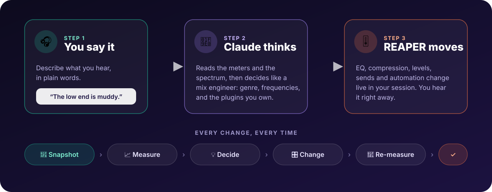
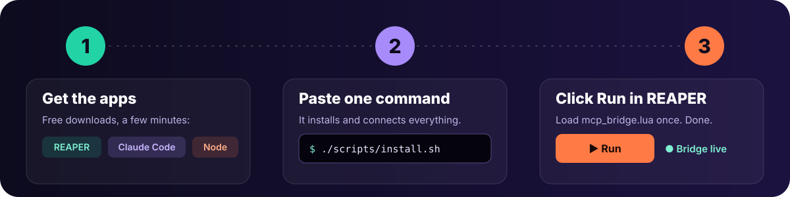
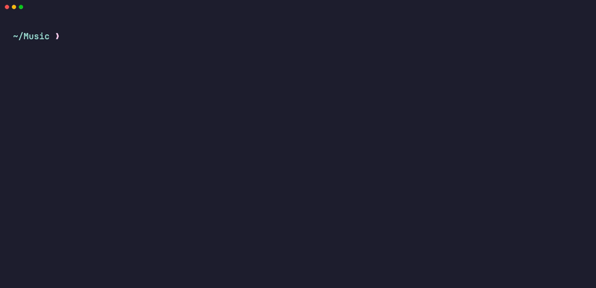
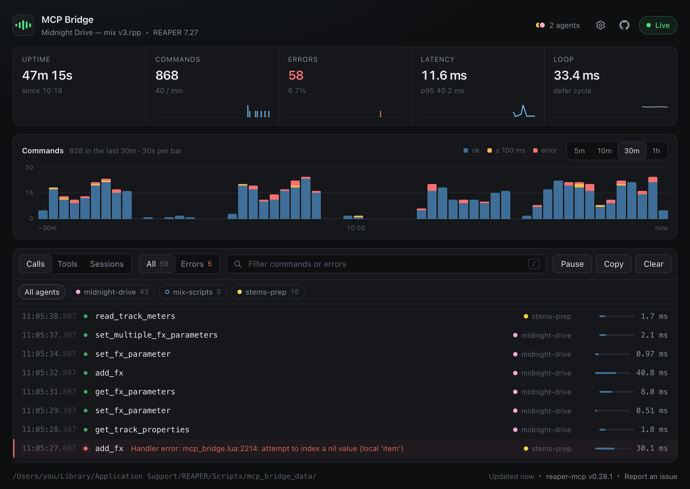

<div align="center">

<picture>
  <source media="(prefers-color-scheme: dark)" srcset="docs/assets/logo-dark.svg">
  
</picture>

<br><br>



<br>

**Tell it what you hear. It measures, decides and makes the change live in your REAPER session.**
<br>
No menus to learn and no exporting. You don't need to code.

<br>

[](https://www.reaper.fm/)
[](https://claude.com/claude-code)
[](https://lorekit.io)
[](#-install-in-3-steps)
[](LICENSE)

[**Install in 3 steps**](#-install-in-3-steps) · [See it work](#-just-say-what-you-hear) · [What you get](#-why-producers-use-it) · [FAQ](#-faq)

</div>

---

## 🎤 Just say what you hear

You know what's wrong with your mix. You just don't want to spend an hour in
plugin windows fixing it. Say it the way you'd say it to an engineer:

> 🎧 *"Please gain stage my tracks."*
>
> 🎤 *"The chorus needs more energy. Make the vocals cut through."*
>
> 🔊 *"I hear some low-end rumble. Can you fix that?"*
>
> 🔥 *"Roast my mix. What could be better?"*
>
> 💿 *"Master this for Spotify."*

Here's what happens next:



It isn't a preset and it isn't a guess. Before it touches anything it **measures your
actual tracks** (loudness, spectrum, stereo width, dynamics). It makes the change with
**the plugins you own**, then **measures again** to check it worked.

---

## ✨ Why producers use it

<table>
<tr>
<td width="33%" valign="top">

### 👂 It measures, then mixes
It reads LUFS, true peak, the frequency spectrum, stereo correlation and crest factor
on every track before it decides anything, and again after. You get numbers, not vibes.

</td>
<td width="33%" valign="top">

### 🎛️ It uses *your* plugins
It finds your installed FX and reaches for the best one you have: **FabFilter Pro-Q 3**
if it's there, **ReaEQ** if not. Anything it doesn't know yet, it learns.

</td>
<td width="33%" valign="top">

### 🛟 You can't lose your mix
It saves a snapshot **before and after** every change, so you can A/B them with one
click. Each edit is a single REAPER undo step.

</td>
</tr>
<tr>
<td valign="top">

### 🎸 It knows the genre
Rock, pop, hip-hop, electronic, metal, orchestral. It adjusts loudness targets, low-end
handling and dynamics to the style. Just tell it what you're making.

</td>
<td valign="top">

### 🧠 It remembers
With **[LoreKit](#-lorekit-the-knowledge-core)** as its memory, it keeps what it learns
about your plugins and your taste, so a correction sticks. It also draws on a shared
plugin library that grows every time someone
**[contributes](knowledge/contributions/README.md)**, you included.

</td>
<td valign="top">

### ⚡ It works live, in real time
It talks straight to your open session, about 50–150 ms per action. You don't bounce
or upload anything, and you hear each change as it happens.

</td>
</tr>
</table>

---

## 🔍 How it works



**You stay in charge.** Ask it to explain before it acts, undo anything, or use
`/critique` for advice without a single change to your project.

---

## 🧠 LoreKit: the knowledge core

A mix engineer's value is what they've learned. reaper-mcp keeps all of that in
**[LoreKit](https://lorekit.io)**, a free, open-source memory store for AI agents. It's
what turns a remote control into an engineer that gets better every session.



- 🎛️ **One record per plugin.** What it is, what each knob does, the settings that
  worked and the gotchas. Ask for a plugin it has never seen and it **researches it,
  inspects it live and writes the record first**, then uses it. You can also teach it
  one with `/learn-plugin`.
- 📝 **Lessons from your corrections.** Revert a change, or have a re-measure come back
  worse, and it saves a lesson right then. A lesson that keeps coming up becomes one of
  the mixer's permanent rules, so it stops making that mistake.
- 🧩 **Built-in knowledge plus your own.** It ships with a curated, read-only set of
  plugin records and lessons, and everything it learns from *you* goes into your own
  layer on top. When the two disagree, yours wins, so your taste never gets
  overwritten. The built-in set comes with the server, read-only, and needs no
  LoreKit account. Connect your own LoreKit to start your layer.
- 🤝 **Share what you taught it.** Press **Contribute** in the bridge page's Plugins tab
  and your plugin records become a pull request. Once the maintainer approves it, they're
  built in for every reaper-mcp user ([how it works](knowledge/contributions/README.md)).
  Regular contributors can publish straight to built-in, no pull request: ask on
  [Discord](https://discord.gg/Eg8tznuXp4).
- 🌍 **It follows you.** The memory isn't tied to one project folder. Whatever song
  you open, it brings what it knows.
- 🔒 **Audio knowledge only.** It never stores client names, song titles or license keys.

> **No LoreKit? It still mixes.** Everything works without it. It just starts from
> scratch every session instead of getting smarter. Genre rules, step-by-step workflows
> and reference sheets (frequencies, compression, loudness) ship with the repo either way.

---

## 🚀 Install in 3 steps



### 1 · Get the apps

| | | |
|---|---|---|
| 🎚️ **REAPER** | your DAW (v6+, v7 recommended) | [reaper.fm](https://www.reaper.fm/) |
| 🤖 **Claude Code** | the AI you talk to | [claude.com/claude-code](https://claude.com/claude-code) |
| 🟢 **Node.js 20+** | runs the connector behind the scenes | [nodejs.org](https://nodejs.org/) |
| 🧠 **LoreKit** *(recommended)* | the memory, so it learns | [lorekit.io](https://lorekit.io) |
| ➕ **SWS Extensions** *(optional)* | extra REAPER powers | [sws-extension.org](https://www.sws-extension.org/) |

### 2 · Paste one command

Open **Terminal** (macOS/Linux) or **Git Bash** (Windows), then paste:

```bash
git clone https://github.com/mthines/reaper-mcp.git && cd reaper-mcp && ./scripts/install.sh
```

That's it. It installs everything, puts the connector into REAPER and sets up Claude Code.
Nothing else to install. When a new version is out, the bridge window in REAPER shows an
**Update** button that does the rest. From a terminal it's `./scripts/update.sh`.



<sub>A real run, recorded by our install test (<code>scripts/test-install.sh</code>). The very first
download takes about a minute.</sub>

### 3 · Click Run in REAPER

In REAPER: **Actions → Show action list → Load ReaScript…**, pick **`mcp_bridge.lua`**
and click **Run**. A small status window opens, showing the bridge is live. 🟢
Running it again stops the bridge.

**Now open Claude Code in any folder (your song folder is perfect) and start mixing:**

```
/mixer Please gain stage my tracks
```

<details>
<summary><b>What did the installer just do?</b></summary>

<br>

1. Installed dependencies and built the server, using the package tools that come
   with Node.js.
2. Copied the bridge script, A/B snapshot scripts and meters (LUFS, spectrum,
   correlation, crest factor) into REAPER, and turned on REAPER's web interface for
   the status window.
3. Linked the mix skills and genre/workflow knowledge into Claude Code.
4. Registered REAPER with Claude Code for your user, so it works from any folder.
5. Pre-approved the REAPER tools in Claude Code, so it doesn't ask permission for every knob.

Check everything any time with `npm run doctor` from the `reaper-mcp` folder. The full
breakdown is in [docs/REFERENCE.md](docs/REFERENCE.md#installation).

</details>

<details>
<summary><b>Something not working?</b></summary>

<br>

- **Run `npm run doctor`** in the `reaper-mcp` folder. It checks the bridge, the
  knowledge and the Claude Code config.
- **Is the bridge running?** The status window shows 🟢 when it is. If not, run
  `mcp_bridge.lua` again from REAPER's action list.
- **Claude Code doesn't see REAPER?** Install Claude Code first, then run
  `./scripts/install.sh` again. It registers REAPER with Claude Code.
- **Newer tools time out after an update?** Run `./scripts/install.sh` again, then click
  **Restart** in the status window's Settings, or run `mcp_bridge.lua` twice (once to stop it,
  once to start the new copy).

</details>

---

## 🎚️ Meet your engineers

Five skills, each tuned for a job. Type the slash command, or just describe what you
want and the right one starts.

| | Skill | What it does | Try |
|---|---|---|---|
| 🎚️ | **`/mixer`** | Does the mixing: gain staging, vocal chains, drum bus, low end, stereo image | `/mixer Build a vocal chain on track 3` |
| 🔥 | **`/critique`** | "Roast my mix." A measured report of what to fix. **Changes nothing.** | `/critique What's holding this mix back?` |
| 💿 | **`/mastering`** | A mastering chain on the mix bus, aimed at a platform's loudness | `/mastering Master this for Spotify` |
| 🎓 | **`/learn-plugin`** | Researches a plugin you own, tests it live and saves it to LoreKit, asking you only what it can't work out | `/learn-plugin JST Gain Reduction Deluxe` |
| 🗂️ | **`/mix-memory`** | Shows what it remembers, and tidies it up | `/mix-memory What do you know about Pro-C 2?` |

---

## 🧰 What it can control

Almost everything in your session. That's **130+ tools**, so it can do the job
instead of just giving advice:

| | | |
|---|---|---|
| 🎚️ **Tracks & mixer**: volume, pan, mute/solo, folders, colors, groups & VCAs | 🎛️ **FX & plugins**: add, tweak, bypass, presets, FX chains, track templates | 📈 **Metering**: LUFS, true peak, spectrum, stereo correlation, crest factor |
| 🔀 **Routing**: sends, buses, sidechains, hardware outputs | 🎹 **MIDI**: write, edit and analyze notes & CC, live MIDI out | ✂️ **Editing**: split, trim, move, fades, takes, stretch markers |
| 📍 **Arrangement**: markers, regions, tempo map | 〰️ **Automation**: envelopes and automation points | 💾 **Project**: save, render, undo/redo, snapshots, REAPER actions |

👉 The main tools by area: **[docs/TOOLS.md](docs/TOOLS.md)**

### 🎸 Genre-aware out of the box

| Genre | Loudness target | What it leans into |
|---|---|---|
| 🎸 Rock | −11 to −9 LUFS | Parallel drum compression, hard-panned guitars |
| 🎤 Pop | −14 to −10 LUFS | Vocal-forward, two-stage compression, bus glue |
| 🎧 Hip-Hop | −10 to −7 LUFS | 808 saturation, aggressive vocal comp, mono sub |
| 🎛️ Electronic | −10 to −6 LUFS | Sidechain pump, mono sub, stereo width |
| 🎻 Orchestral | −23 to −16 LUFS | Preserved dynamics, hall reverb staging |
| 🤘 Metal | −11 to −8 LUFS | Scooped guitars, tight drums, four-guitar wall |

---

## 🛟 Safe by design

- 📸 **Snapshots before and after every change.** A/B them in REAPER with the Snapshot
  Manager, or bind *next/previous snapshot* to keys.
- ↩️ **One change, one undo.** Each edit is labelled `MCP: …` in REAPER's undo history.
- 🚫 **No surprise pop-ups.** It won't run anything that opens a dialog unless you allow
  it, and it never closes your project or quits REAPER.
- 👀 **Advice-only mode.** `/critique` never changes your project. The bridge window
  also has a read-only switch and a pause button.
- 📊 **Bridge status window.** See every action as it happens, with timing and errors,
  in a small window next to REAPER.

### 👀 Watch it work

The bridge status window opens next to REAPER when you click Run. It shows every
move the AI makes, as it happens: what it did, how long it took, and anything that
went wrong. With several Claude sessions connected at once, you can see which one
did what.



<sub>Demo data. Add <code>?demo</code> to the window's address to explore it without REAPER.</sub>

---

## 🔒 Privacy & telemetry

Hi 👋 reaper-mcp isn't a company — it's just me. I'm a developer who loves making music,
and I build this in my spare time because it's the tool I wanted for my own sessions 🎛️

The catch: I can only test it on my own setup. To make sure it also works on yours —
other REAPER versions, other plugins, other OSes — reaper-mcp sends **pseudonymous usage
data** by default: which tools run, whether they fail, and how long they take. A random
install id groups one machine's calls together. It isn't tied to your name, account or
computer.

**Never sent:** your projects, track or plugin names, settings, file paths, error
messages, audio or MIDI. I respect your privacy 🙏

You're in control: setup asks before anything is sent, and `reaper-mcp telemetry off`
turns it off for good — no hard feelings. Everything that's collected, and where it
goes, is in [TELEMETRY.md](TELEMETRY.md).

---

## ❓ FAQ

<details>
<summary><b>Do I need to know how to code?</b></summary>
<br>
No. You paste one command to install. After that you talk in plain words, the way you
would to an engineer.
</details>

<details>
<summary><b>Will it replace me?</b></summary>
<br>
No. It handles the tedious, measurable parts: gain staging, cleaning up clashing
frequencies, hitting loudness targets. Taste and the final call stay with you, and it
explains its reasoning so you can push back.
</details>

<details>
<summary><b>Can it wreck my project?</b></summary>
<br>
Every change is bracketed by snapshots and is a single undo step. Use
<code>/critique</code> if you only want advice. Saving a copy of your project before a
big session never hurts.
</details>

<details>
<summary><b>Which plugins does it work with?</b></summary>
<br>
Any plugin REAPER can load (VST, VST3, AU, CLAP, JS). It finds what you have installed
and reaches for the best tool for each job. When it meets a plugin it doesn't know, it
researches it, inspects its controls live and saves what it learns to LoreKit. You can
also teach it one up front with <code>/learn-plugin</code>.
</details>

<details>
<summary><b>What does it cost?</b></summary>
<br>
reaper-mcp is free and open source (MIT), and so is LoreKit. You need REAPER and a
Claude plan that includes Claude Code.
</details>

<details>
<summary><b>Do my audio files get uploaded?</b></summary>
<br>
No. It reads meter values and settings from your running session, not your audio files.
</details>

---

## 🛠️ For developers

- 📖 **[docs/REFERENCE.md](docs/REFERENCE.md)**: architecture, install internals, CLI,
  environment variables, telemetry, project structure
- 🧰 **[docs/TOOLS.md](docs/TOOLS.md)**: the main tools by area
- 🧑‍💻 **[DEVELOPMENT.md](DEVELOPMENT.md)**: build, test, run from source, MCP Inspector
- 🧪 **[docs/TESTING.md](docs/TESTING.md)**: end-to-end testing guide

```
Claude Code ⇄ MCP server (TypeScript) ⇄ file IPC ⇄ Lua bridge in REAPER ⇄ ReaScript API + JSFX meters
```

<div align="center">

<br>

**Made for people who'd rather be making music.** 🎶

MIT License

</div>
