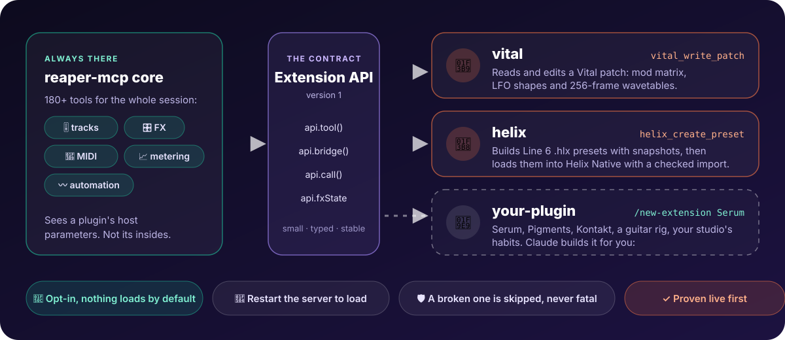

# Extensions



**Extensions teach reaper-mcp things that don't belong in core**: one synth's mod matrix, one amp modeler's presets, one
studio's habits. Core already controls every plugin through its host parameters. An extension reaches what those
parameters can't: a wavetable, a modulation matrix, a patch graph, a preset file.

- 🔌 **Opt-in.** Nothing loads unless you install it.
- 🧱 **Outside the server bundle.** An extension is a folder with a manifest; core never imports it.
- 📜 **One small, versioned contract.** It sees reaper-mcp only through `ExtensionApi` (`libs/extension-api`).
- 🛡️ **Never fatal.** A broken extension is skipped with a reason on stderr; `serve` keeps running.
- 🤖 **Claude can build one for you.** Type `/new-extension Serum` and it researches the format, probes the plugin,
  writes the tools and tests, and proves them on a scratch track. See [Build one with Claude](#build-one-with-claude).

| In this repo | Does |
|---|---|
| [`vital`](#the-vital-extension) | Read and edit a Vital synth patch: settings, mod matrix, LFO shapes, wavetables |
| [`helix`](#the-helix-extension) | Build, edit and validate Line 6 Helix `.hlx` presets; load them into Helix Native with a checked import |
| [`composition`](#the-composition-extension) | Write MIDI from notation: chord progressions and step-sequencer drum patterns |

## Contents

[Quick start](#quick-start) · [When an extension is the right tool](#when-an-extension-is-the-right-tool) · [Manage extensions](#manage-extensions) ·
[Anatomy](#anatomy) · [The API](#the-api-version-1) · [Lua handlers](#lua-handlers) · [Plugin state](#plugin-state-apifxstate) ·
[Three kinds of extension](#three-kinds-of-extension) · [Designing good tools](#designing-good-tools) · [Writing and testing](#writing-and-testing-one) ·
[Build one with Claude](#build-one-with-claude) · [Share one](#share-one) · [Trust](#trust) · [Troubleshooting](#troubleshooting) ·
[Vital](#the-vital-extension) · [Helix](#the-helix-extension) · [Composition](#the-composition-extension) · [Not built yet](#not-built-yet)

## Quick start

**Use one** (Vital, from this clone):

```bash
pnpm nx build vital                  # extensions ship as source here: build once
reaper-mcp extension add vital       # links extensions/vital, so it stays in step with git pull
# restart Claude Code (or the MCP server), then:
#   "Read the Vital patch on track 2 and make the LFO on the filter a slow triangle."
```

**Make one** in about two minutes:

```bash
reaper-mcp extension new my-synth --dir .   # scaffolds ./my-synth: manifest + index.mjs with a working tool
reaper-mcp extension link ./my-synth        # use the working copy live
node scripts/ext-call.mjs my_synth_hello '{"name":"Ada"}'   # try it now, no restart (needs a built server and a running bridge)
```

`ext-call.mjs` starts a fresh `reaper-mcp serve`, so a new or rebuilt extension can be called straight away. A running
Claude Code session sees new tools only after a restart.

For a real plugin, skip the hand-work and run `/new-extension <plugin>` in Claude Code.

## When an extension is the right tool

| You want Claude to… | Use |
|---|---|
| set a plugin's knobs, switches and enums | core (`get_fx_parameters`, `set_fx_parameter`); teach it the plugin with **`/learn-plugin`** |
| change what host parameters can't reach (wavetables, mod matrix, patch graph, preset files) | **an extension** (`/new-extension`) |
| do one multi-step edit in a single call | `run_plan` in core, no extension |
| repeat a studio habit (your bus layout, your naming) | a skill in `.claude/skills/` first; an extension only if it needs new REAPER powers |

Check before you build: `reaper-mcp extension list`, `ls extensions/`, and `list_tool_categories` (each extension appears as a
category). If one already covers the plugin, extend it.

## Manage extensions

```bash
reaper-mcp extension list [--json]          # installed extensions, version, and why one is not loadable
reaper-mcp extension add vital              # an extension in this clone's extensions/ folder (linked)
reaper-mcp extension add ./my-extension     # a folder with a manifest (copied)
reaper-mcp extension add https://github.com/someone/their-extension.git   # asks first: it runs as code on your machine
reaper-mcp extension link ./my-extension    # a working copy, used live
reaper-mcp extension remove vital           # a linked folder itself is never deleted
reaper-mcp extension new my-synth [--dir <parent>]   # scaffold one
reaper-mcp doctor                           # an Extensions section: manifest valid, entry and Lua files present
```

| Flag | On | Meaning |
|---|---|---|
| `--yes`, `-y` | `add <git-url>` | Skip the "this is code" question (required without a terminal) |
| `--force` | `add`, `link` | Replace an extension of the same name |
| `--dir <parent>` | `new` | Where to create the folder (default: the current folder) |
| `--json` | `list` | Machine-readable list |

Extensions install into `~/.reaper-mcp/extensions/<name>/` (`REAPER_MCP_EXTENSIONS` overrides). The MCP server loads them at
start, so **restart it (or the Claude Code session) after adding, updating or removing one**.

## Anatomy

```
my-synth/
  reaper-mcp-extension.json   manifest
  index.mjs                   ES module: export default { register(api) { … } }
  handlers.lua                optional: Lua commands that run inside REAPER (api.call)
```

```json
{ "name": "my-synth", "version": "0.1.0", "apiVersion": 1, "description": "…", "main": "index.mjs", "lua": "handlers.lua" }
```

| Field | Required | Rules |
|---|---|---|
| `name` | yes | 2-32 characters: lowercase letters, digits, dashes, starting with a letter. Must equal the folder name. Every tool becomes `<name>_<tool>` (dashes become underscores). |
| `version` | yes | Semantic version (`1.2.0`). |
| `apiVersion` | yes | The extension API it was written against: `1`. Another value is refused with a message saying which side to update. |
| `main` | yes | Path to the ES module inside the folder (no `..`, no symlink out of it). |
| `lua` | no | Path to the Lua handlers file, same rules. |
| `description`, `author`, `homepage` | no | Strings. `description` is the fallback for the tool category. |

```js
export default {
  register(api) {
    const { z } = api;
    api.tool('hello', 'Say hello and read the project', { name: z.string().optional() }, async ({ name }) => {
      const info = await api.bridge('get_project_info');
      return info.success ? api.json({ hello: name ?? 'world', project: info.data }) : api.error(info.error);
    });
    api.describeCategory('One sentence for list_tool_categories');
  },
};
```

`register` may be async but must finish within **10 s**. A throw, a timeout, a missing file or a duplicate tool name skips
the whole extension and removes the tools it had registered.

## The API (version 1)

Source of truth: `libs/extension-api/src/types.ts`.

| Member | What it does |
|---|---|
| `api.tool(name, description, zodShape, handler)` | Register an MCP tool as `<ext>_<name>`. `name` is lowercase letters, digits, underscores. A thrown error becomes an `Error:` result. Use `z.coerce.number()` for numbers: clients sometimes send `"39"`. |
| `api.bridge(command, params?, timeoutMs?)` | Run any of reaper-mcp's own bridge commands (`get_track_properties`, `add_fx`, `render_track_to_wav`, …). Returns `{ success, data?, error? }`. |
| `api.call(command, params?, timeoutMs?)` | Run a command from your `handlers.lua`. `params` must be JSON. |
| `api.fxState.get({trackIndex, fxIndex})` / `.set(loc, state, {expectName})` | Read and replace a **VST3** plugin's saved state. Returns `{ ok, value }` or `{ ok: false, error }`. |
| `api.reply(res)` | A bridge answer as a tool result (its data as JSON, or `Error: …`). |
| `api.json(data)` / `api.error(msg)` | A JSON result / a refusal the agent reads (flagged `isError`). |
| `api.describeCategory(text)` | Describe your tools in `list_tool_categories`; they appear as one category named after the extension. |
| `api.name`, `api.apiVersion`, `api.z` | Your name, the API version, and zod. |

An extension imports **only** from `@reaper-mcp/extension-api` (types, `validateManifest`, VST3 helpers). In this repo that is
enforced: a project tagged `type:extension` may depend only on `type:extension-api` (`eslint.config.mjs`).

**Versioning.** `EXTENSION_API_VERSION` is bumped only when a change would be noticed by an existing extension. Until then,
adding members is safe. The server refuses an extension built for another version, and `reaper-mcp doctor` says so.

## Lua handlers

For work that must run inside REAPER (ReaScript calls an existing bridge command doesn't cover):

```lua
return {
  my_command = function(params, host)       -- host = { reaper, plan, fxstate, json_decode }
    return { ok = true }                    -- or: return nil, "why it was refused"
  end,
}
```

Call it with `api.call('my_command', { … })`. Command names are `[A-Za-z_][A-Za-z0-9_]*`.

- The server copies the file to `<bridge folder>/extensions/<name>/handlers.lua` when it loads the extension, and the bridge
  reloads it when its text changes, so a Lua edit needs a server restart but **not** a bridge restart.
- Returning `nil, "reason"` is a refusal the agent sees. A crash is reported as `Handler error:` (a system fault).
- The bridge must be recent enough to know `extension_call`: `reaper-mcp setup`, then restart the bridge script.
- `params` arrives already decoded (`api.call` sends it as one JSON string and the bridge unpacks it); use `host.json_decode`
  for JSON you nest inside a string. Big payloads (plugin state, audio) travel as files in the bridge folder, never inside a command.
- Keep a handler short and do the thinking in TypeScript: Lua can't be unit-tested outside REAPER the way TS can.

## Plugin state (`api.fxState`)

Saved state is megabytes, so it travels as files in the bridge folder, never inside the command JSON. For a VST3, REAPER
keeps a 44-byte header and the state, each with a length it checks. `fxState.set` fixes both lengths for you, gives the FX a
new `FXID` (REAPER keeps the loaded instance and ignores new state otherwise), checks the state REAPER holds is consistent
first, and with `expectName` refuses a wrong FX index. What is *inside* the state (a JUCE bank, JSON, a binary blob) is your
extension's job; see `extensions/vital/src/state.ts`.

**Supported:** VST3. **Not yet:** VST2, AU, CLAP and plugins inside FX containers (all refused with a message). A write reloads the
plugin, so held notes cut off: don't write mid-playback. A plugin may save itself with trailing bytes after loading your
write; parse tolerantly and keep them.

## Three kinds of extension

Pick the shape the plugin allows. All three are real, shipped examples.

| Kind | When | Example | Moving parts |
|---|---|---|---|
| **State editor** | The plugin is a VST3 and its saved state holds a documented or recoverable format | `vital` | `api.fxState` + a parser/builder (`state.ts`) + pure edit functions |
| **File-format builder** | The plugin's state is closed or encrypted but it imports a documented preset file | `helix` | Node file I/O on the preset format + validation + a checked import step |
| **Bridge composer** | The job is a new multi-step workflow over REAPER, no plugin internals | the scaffold's `hello` | `api.bridge` calls, optionally a `handlers.lua` |

Choosing: try the state editor first (it edits the live instance). If the state blob is encrypted (Helix Native's is), use the
file format. If host parameters already cover it, you don't need an extension.

## Designing good tools

Tools are read by an agent with a small context, so shape them for that:

- **Summary first.** A `read_*` tool returns structure, names and counts. Raw values come only on request (a
  `settingsMatching` filter, pagination). Never return the whole state.
- **Validate, then write.** One bad edit refuses the whole call and changes nothing. Say what was wrong and what is valid.
- **`dryRun`.** Every write tool offers it and returns before → after.
- **One undo point.** Say how to undo (`undo_project`).
- **A domain tool beats a generic one.** `vital_set_wavetable` (build a wavetable from harmonics) over "set bytes 1200-1400".
- **Say when to use it.** The description tells an agent *when* to call the tool, the units, and what it won't do.
- **Locate automatically.** If exactly one matching plugin is on the track, don't make the agent pass an FX index.
- **Never touch what you weren't asked to.** Keep the user's selection, transport and track list as they were.

## Writing and testing one

- **In this repo:** `extensions/<name>/` is a pnpm workspace package tagged `type:extension`, built to `dist/index.mjs` with
  esbuild (`extensions/vital/project.json` is the template; also copy its `tsconfig.json` and `vitest.config.ts`). The
  manifest's `main` points at `dist/index.mjs`. Run `pnpm install` once so the package links.
- **Outside this repo:** plain JavaScript works as-is (`reaper-mcp extension new`). For TypeScript, bundle to one `.mjs` file
  with everything inlined (the extension has no `node_modules` at runtime) and depend on `@reaper-mcp/extension-api` for types only.
- **Test behaviour, not wiring.** Drive your tools through a fake `ExtensionApi`
  (`extensions/vital/src/__fixtures__/fake-api.ts`) and assert what the agent gets and what state REAPER ends up with. Mock
  only REAPER.
- **Keep logic in pure functions** (parse, edit, build) and unit-test them with real fixtures: a few small, real, non-personal
  saved states. The round trip `build(parse(x), {})` must equal `x` byte for byte.
- **Prove it live.** Add a scratch track, run the tools through `node scripts/ext-call.mjs`, read back the change, and measure
  that it sounds different (`analyze_track_offline` before and after). A matching read-back doesn't prove the plugin loaded it.
- Gates: `pnpm nx run-many --target=build,lint,typecheck,test --projects=<name>`, then `reaper-mcp doctor`.

## Build one with Claude

```
/new-extension Serum
/new-extension update vital: add macro support
```

The skill (`.claude/skills/new-extension/SKILL.md`) does the whole job, for a new extension or a change to an existing one:

1. Scopes it and checks it is worth building (already exists? host parameters enough? a VST3?).
2. Researches how the plugin stores its state (vendor docs, open-source parsers, forum threads), keeping the URLs.
3. Scaffolds the extension and probes the real state on a scratch track, learning the layout by changing one thing and diffing.
4. Proposes the tool list and waits for your answer.
5. Implements with behaviour tests first (round trip, exact edits, refusals, trailing bytes).
6. Proves it live: read, dry run, write, read back, audible change, two writes in a row, undo.
7. Runs the gates, then documents it here, in `CLAUDE.md` and in the root README, and saves the plugin record and
   lessons to LoreKit so the mixing skills know it.
8. Reports what it verified (with numbers) and what it didn't. It never commits unless you ask.

It works on a scratch track named `[MCP] extension-research <TAG>`, never your tracks, and deletes it when done.

## Share one

An extension is a folder, so sharing is a git repo with the manifest at its root:

```
my-extension/
  reaper-mcp-extension.json
  dist/index.mjs         (commit the built file: `add <git-url>` installs the repo as it is, it does not build)
  handlers.lua
  README.md              what it does, which plugin version you tested, the tools
```

Others install it with `reaper-mcp extension add https://github.com/you/my-extension.git`. Put the tested plugin version and
the `apiVersion` in the README, and bump `version` when tools change. Extensions that are broadly useful can be proposed as a
PR into `extensions/`.

## Trust

An extension is code: TypeScript running as your user inside the MCP server, and Lua inside REAPER. `extension add <git-url>`
shows the source folder and asks first; read it. The manifest declares no permissions because none would be enforced.
Extension tools are not in the Claude Code allow-list `reaper-mcp init` writes, so Claude Code asks before each new one.

## Troubleshooting

`reaper-mcp extension list` and `reaper-mcp doctor` say why an extension isn't loadable. The server prints skipped
extensions on stderr when it starts.

| Symptom | Likely cause and fix |
|---|---|
| Tools don't show up in Claude Code | The server loads extensions at start: restart Claude Code or the MCP server. `list_tool_categories` shows each loaded extension. |
| `"main" file … does not exist (is the extension built?)` | Build it: `pnpm nx build <name>`. |
| `folder name "x" must match the manifest name "y"` | Rename the folder or the manifest `name`. |
| `"apiVersion" is N but this reaper-mcp runs extension API 1` | Update the extension, or reaper-mcp. |
| `tool "x_y" is already registered` | Two `api.tool` calls with the same name, or two extensions with the same prefix. |
| `register() did not finish within 10 s` | `register` must only register tools. Do slow work inside a tool handler. |
| `extension 'x' has no Lua handlers installed` | The manifest needs a `lua` file and the server must have loaded the extension. |
| `extension 'x' has no Lua command 'y'` / `handlers.lua does not compile` | The file must `return { y = function(params, host) … end }`; the message names the Lua error. |
| `Unknown command type: extension_call` | The bridge is older than the server: `reaper-mcp setup`, then restart the bridge script. |
| A state write is accepted but sounds unchanged | The FX didn't get a new `FXID` (use `fxState.set`, never edit the chunk), or the plugin was offline (3 parameters = not loaded). |
| `fxState` refuses the FX | Only VST3 is supported; check the FX name with `search_fx`. |

Environment: `REAPER_MCP_EXTENSIONS` (install folder), `REAPER_RESOURCE_PATH` (where the bridge folder lives; point it at a temp
folder when running live-REAPER test suites so they don't touch your bridge).

## The Vital extension

`extensions/vital` edits a Vital patch through its saved state (the same JSON as a `.vital` file):

| Tool | |
|---|---|
| `vital_read_patch` | Oscillators with wavetable names and frame counts, filters, LFOs, effects on, every mod route with its amount; raw values of settings matching a substring |
| `vital_write_patch` | Settings by Vital's names, mod-matrix routes (add / update / remove), LFO shapes; validated as one unit, `dryRun` available |
| `vital_set_wavetable` | 1-256 frames from classic shapes or additive harmonic recipes, morphing across the position axis |

Not yet: wavetables from audio files, spectral/warp components, the sample slot, effect-section helpers, macros.
Lessons from building it (VST3 length fields, FXID) are in LoreKit under `repo::mthines/reaper-mcp`.

## The Composition extension

`extensions/composition` writes MIDI from notation. It is an extension, not core, because what to write is a musical taste call; the
core MIDI tools stay objective (quantize, transform, import, key and chord detection). It only writes notes: it never picks a sound.

| Tool | |
|---|---|
| `composition_chord_progression` | `"Cm7, Fm7, Bb7, Eb"` (commas, spaces or `\|`) to voiced notes: major, minor, dim, aug, sus, 6, 7, maj7, m7, m7b5, dim7, 9, add9 and more; slash bass (`C/E`), per-chord length (`Am:2`), octave, inversion, bass note |
| `composition_drum_pattern` | Step-sequencer lanes (`"kick": "x---x---"`, `x` hit, `X` accent, `o` ghost) to notes; `gm` or `invasion` (GetGood Drums, not GM) map, per-lane `pitches`, steps per beat, repeat, swing |

Both write into the item you name, or create one at `positionSeconds` sized to the notes (project tempo; the tempo map is not followed), and
warn when the notes outrun an existing item. The whole input is checked first: a bad chord, an unknown drum lane or lanes of unequal length
write nothing and say which token. `dryRun` shows the notes. A lane the drum map lacks is refused with the lanes it has, never guessed
(a wrong GM note once played the floor toms on Invasion).

Not built yet: loop-folder scan (BPM and key from filenames) and a vocal chop pipeline (see `docs/PLAN-gap-closing.md`).

## The Helix extension

`extensions/helix` works on Line 6 `.hlx` presets (plain JSON), because Helix Native's saved plugin state is encrypted and
cannot be edited through `api.fxState`. Blocks are cloned from real presets, so model ids and parameter names are never invented.

| Tool | |
|---|---|
| `helix_guide` | The Helix knowledge (format, model catalog, chain design, genre recipes incl. Sleep Token, snapshot rules, parameter encoding) |
| `helix_inspect_preset` | Chains, boot snapshot, routing, every snapshot, and validation findings |
| `helix_list_models` | Models (and a model's real parameters) found in your `.hlx` library: the source of valid ids |
| `helix_create_preset` | Build a preset from a donor: your blocks per path, up to 8 snapshots (bypass + per-snapshot values), validated; `dryRun` |
| `helix_edit_preset` | Rename, tempo, block parameters, per-snapshot blocks and values; load-time state re-synced; writes a copy or overwrites with a `.bak` |
| `helix_set_preset` | Load a `.hlx` into one library slot of a live Helix Native, then verify on disk and roll back if anything else changed |
| `helix_backup_library` | Copy the whole preset library to `~/.reaper-mcp/helix/library-backups/` |

`helix_set_preset` runs Helix Native's Import through a **driver you configure**: `~/.reaper-mcp/helix-import.json` with
`{"command": ["osascript", "/path/import.scpt", "{file}"]}` (`{file}` becomes the `.hlx` path; override with `HELIX_IMPORT_CONFIG`). The
extension owns the safety, not the clicking: the instance must be online (3 parameters = offline, refused), the library is backed up, and after
the driver returns exactly the slot you named (`setlist`/`preset`) must have changed, or the library is restored. Choose a scratch slot.
Env: `HELIX_PRESET_DIRS` (colon-separated folders scanned for templates), `HELIX_PRESET_OUT`, `HELIX_NATIVE_LIBRARY`.

Not yet: the import driver itself (needs calibrating against the live plugin window), adding or removing blocks in `edit_preset`
(use `create_preset`), `.hls` setlists, footswitch assignments (created presets carry none), IR slots.

## Not built yet

- A separate collection repo with a `registry.json` (`extension add <name>` would resolve through it). Extensions live in
  `extensions/` until the API is stable; the import boundary above is what keeps splitting them out a `git mv`.
- Allow-listing a vetted extension's tools in `init`.
- `fxState` for VST2, AU, CLAP and FX inside containers.
