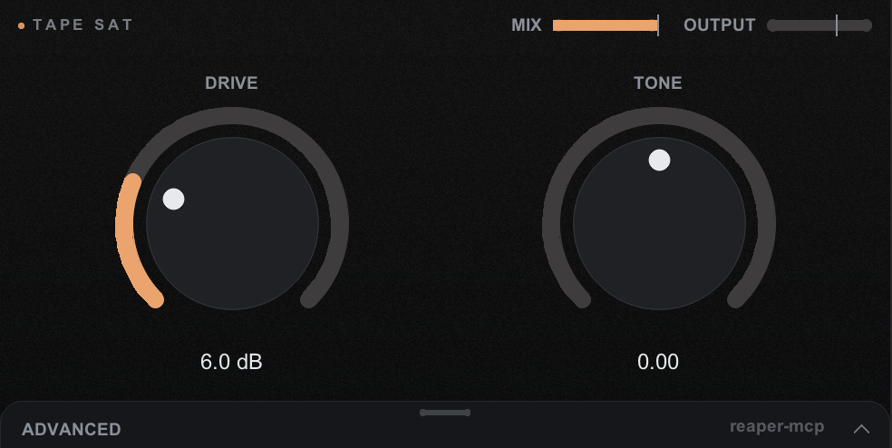
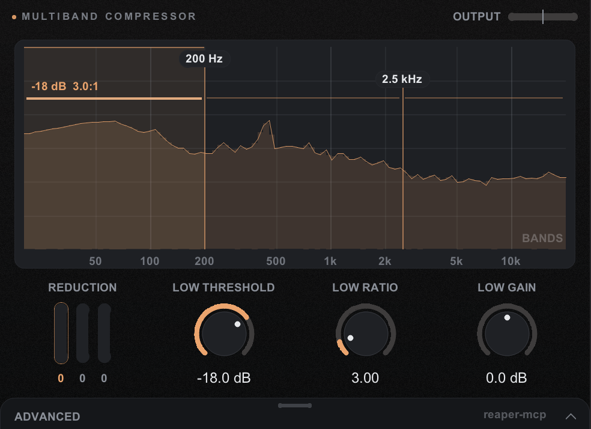
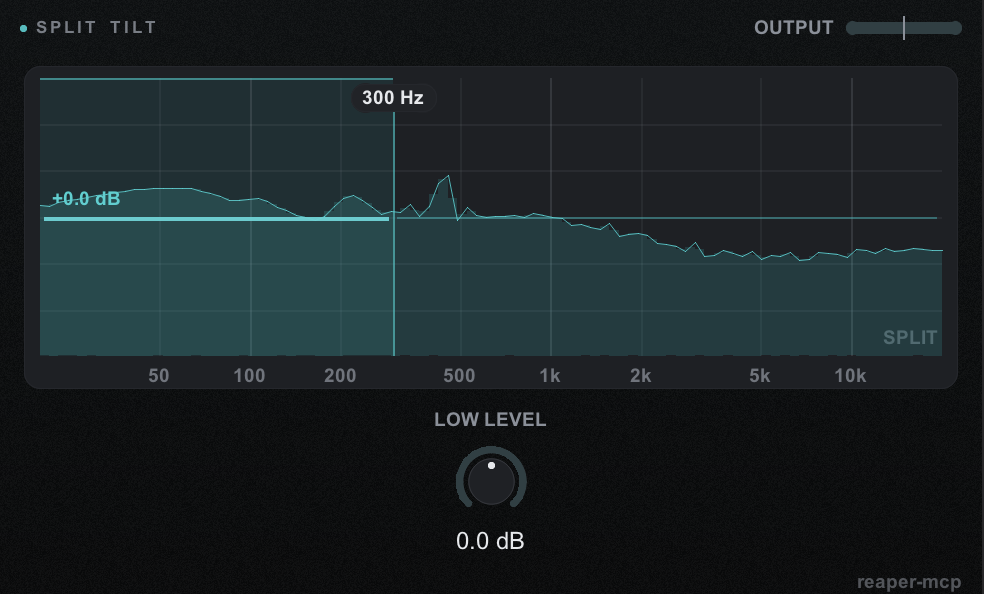
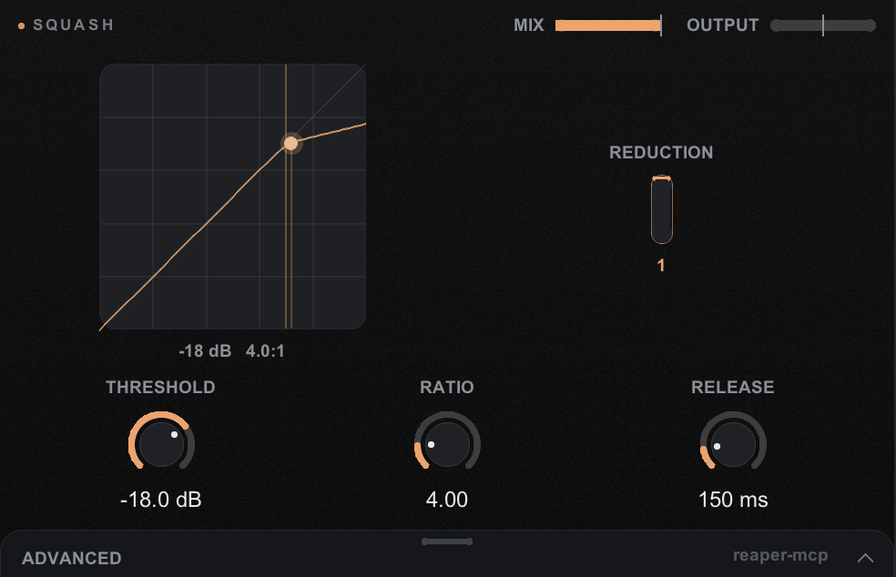
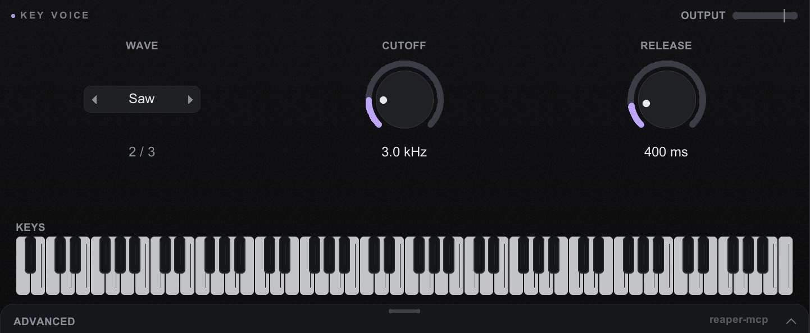

# Plugin authoring (`/make-plugin`)

Ask for a plugin that doesn't exist ("randomly mutate my samples and add reverb", "keep my bass
mono", "a trance gate") and Claude writes it, loads it on a scratch track, proves by measurement
that it does the thing, and leaves you a plugin in REAPER's FX browser under
**reaper-mcp-generated**.

**It is just a plugin.** A generated plugin is one `.jsfx` file that contains everything it
needs. Copy it to another machine with REAPER and it works: no reaper-mcp, no bridge, no
browser, and no telemetry inside it.

## Principles

1. **Simple.** The smallest plugin that does what was asked.
2. **Fast.** Coefficients are computed when a knob changes, never per sample; buffers are
   allocated once; the UI redraws only when something changed.
3. **Advanced controls by progressive disclosure.** The core view has 3-5 controls and fills
   the window. Everything else is in an **Advanced** drawer: a bar along the bottom that slides
   up over the core view, which keeps its size and position (it dims behind the drawer). The lint
   enforces the counts (at most 5 core widgets, at most 8 advanced).
4. **Presets that teach.** Each plugin ships 3-5 suggested presets named for their intent
   ("Ghost tails", "Warm bus"), in REAPER's own preset dropdown.

Every parameter is a real REAPER parameter, so automation, MIDI learn and the plain slider view
work as usual.

## How it fits together

| Piece | Where |
|---|---|
| The skill | `.claude/skills/make-plugin/` (`SKILL.md`, `examples/`, `reference/`) |
| The UI toolkit, drawn with JSFX's `@gfx` | `reaper/mcp_ui.jsfx-inc` |
| `write_jsfx`: lint, inline the toolkit, write | `apps/reaper-mcp-server/src/tools/jsfx.ts`, `src/jsfx/lint.ts`, `src/jsfx/inline.ts` |
| `report_plugin_build`: how a run ended | `apps/reaper-mcp-server/src/tools/plugin-build.ts` |
| Your plugins | `<REAPER>/Effects/reaper-mcp-generated/<name>.jsfx` |
| Their suggested presets | `<REAPER>/presets/js-reaper-mcp-generated_<name>_jsfx.ini` (REAPER's own file; written by `src/jsfx/presets.ts`) |
| Earlier versions of a plugin | `~/.config/reaper-mcp/jsfx-history/<name>/` (outside `Effects/`, so REAPER never scans them; `REAPER_MCP_CONFIG_DIR` overrides the folder) |
| The four examples | `Effects/reaper-mcp-generated/examples/`, installed by `reaper-mcp setup` (a copy you edited is never overwritten) |

`write_jsfx` pastes the toolkit into the plugin's `@init`, so the file never depends on
`mcp_ui.jsfx-inc` being installed. Editing a plugin means passing the whole file back: the old
toolkit block is replaced by the current one. An existing slider is never renumbered, re-ranged
or removed without `breaking: true`, because projects store automation by slider number.

## Header bars

Mix and Output sit in the top right of every plugin that has them (`ui_header(mix, out)`) as slim horizontal bars, vertically centred with the plugin name and always visible, so the core view holds only what is special about the plugin.

## Gallery

What a generated plugin can draw today. Every window has the plugin name top-left and, when the plugin has them,
Mix and Output as bars top-right; the Advanced drawer sits along the bottom. Screenshots are real REAPER 7 windows.

| | |
|---|---|
| **Knobs** (`ui_knob`): Tape Sat, two core knobs and Mix / Output in the header  | **Frequency graph with draggable bands** (`ui_freqgraph`, `ui_fhandle`, `ui_fthresh`): Multiband Compressor, crossovers in Hz and a threshold line per band, reduction bars below  |
| **Per-band levels** (`ui_fband`, `ui_bandknob`): Split Tilt, one level per side of the crossover, drag a band up or down  | **Transfer curve and reduction meter** (`ui_transfer`, `ui_grmeter`): Squash  |
| **Playable keyboard** (`ui_keyboard`, read with `ui_kpoll`): Key Voice, 88 keys along the bottom, click or drag to play  | |

The shots were taken while a broadband test signal played, so the graphs show the live spectrum trace.
The sources are in `.claude/skills/make-plugin/examples/` (Tape Sat, Multiband Compressor); Split Tilt, Squash and
Key Voice were built with `/make-plugin` to show the widgets.

## Graphs

Besides knobs, toggles, choices and the level meter, the toolkit (v1.3) draws graphs a plugin feeds:
`ui_freqgraph` (a log 20 Hz-20 kHz frequency graph with a spectrum trace) with draggable band
handles `ui_fhandle` bound to Hz sliders, `ui_grmeter` (per-band gain reduction), `ui_transfer` (a
compressor curve with the live level) and `ui_keyboard` (MIDI notes). A multiband compressor
(`examples/multiband-compressor.jsfx`) shows the crossovers on the spectrum, drag them to pick the
bands in Hz, every band has its own threshold line (hover a band and drag up or down, Shift-drag for its gain; click a band and the Threshold, Ratio and Gain knobs edit it), and the bars show how much each band is compressed. A Compare input toggle in Advanced draws the input spectrum over the output one (before and after). Every plugin also shows its name,
small and in spaced capitals, at the top-left. Graph feeds redraw only on activity
(`ui_boot(2)`). Reference: `.claude/skills/make-plugin/reference/toolkit.md`. The lint refuses a
`ui_` call the toolkit does not define and a wrong argument count (`unknown-ui-call`, `ui-arity`),
and `write_jsfx` reports how many graph widgets a plugin uses (`reaper.jsfx.graphs`, a count only).

## Presets

`write_jsfx` takes `presets: [{name, values}]` (values keyed by slider label or index, in the
slider's own units; a slider left out takes its default). Every value is checked against its
slider's range and step first, and one bad value refuses the whole call. They are written in
REAPER's JSFX preset format, read from REAPER 7.40's own files and proven live (the preset
appears in the dropdown, loading it sets the sliders):

- file: `<resource>/presets/js-<path under Effects/, "/" and "." as "_">.ini`
- `[General] NbPresets=n`, then `[PresetK]` with `Data=`, `Len=`, `Name=`
- `Data` is the hex of `v1 v2 … v64 "<name>"` (64 slider values as `%f`, `-` for a slider the
  plugin does not declare) plus one checksum byte (the sum of those bytes & 255); `Len` is the
  byte count without the checksum.

Presets the user saved live in the same file and are kept: a manifest
(`jsfx-history/<name>/presets.json`) remembers the presets we wrote, and only those, unchanged,
are replaced. One the user changed in REAPER keeps their values. A `breaking: true` edit without
`presets` removes ours, since the sliders now mean something else. The shipped examples carry
theirs in `examples/<name>.presets.json`, installed by `reaper-mcp setup` the same way.

## The UI

The toolkit draws a ring knob (one anti-aliased stroke for the track and one for the value, bipolar
ranges drawn from 0), a pill toggle, a stepping choice box and a peak meter, each as one block:
label above, control, value below. REAPER re-runs `@init` on every Play, so the toolkit sets its
UI state once (the drawer stays open while playing). It hides REAPER's slider panel above the UI
(the sliders remain parameters) and shows a small "reaper-mcp" credit at the bottom right; a
click opens an About dialog drawn in the plugin (what reaper-mcp is, the repository address as
plain text since JSFX cannot open a URL, and the plugin's name, version, toolkit version, accent,
control count and the day it was written; `ui_credit = 0` in the toolkit hides it).

Gestures follow the FabFilter/Serum convention: drag, Shift-drag for fine, wheel, double-click
to type a value (Enter sets it, a click outside cancels), Cmd/Ctrl/Alt-click to reset. Esc never
reaches a plugin in a floating FX window with REAPER's defaults: REAPER closes the window first
(probed in 7.40). With the window's **+ > Send all keyboard input to plug-in** on, Esc closes the
value box, the About dialog, then the drawer.

### Accent and background

Every plugin has its own accent colour: the knob value arcs, hover and drag, the Advanced title,
the toggle's on state, the footer hover and a faint tint in the background gradient (meters keep
green, amber and red). `write_jsfx`'s `accent`:

- left out: keep the plugin's current accent (the file keeps a chosen one as `// accent: …`);
- `"auto"` (the default for a new plugin): from the slug (FNV-1a hash → an OKLCH hue at
  L 0.78 / C 0.13, skipping ±22° around the meter colours), so the same plugin always gets the
  same colour;
- a name (`blue`, `teal`, `green`, `amber`, `orange`, `red`, `pink`, `violet`) or `"#rrggbb"`.

An unknown name or a bad hex refuses the whole call (outcome `refused_accent`). Every auto and
named accent has a contrast ratio of at least 7 on the background (tested). The examples use
violet (Mutate Verb), orange (Tape Sat) and teal (Width / Bass Mono).

The background is a very subtle vertical gradient (a hair lighter and tinted at the top, a hair
darker at the bottom) with film grain from one 128 px noise tile, rendered once into an
offscreen image and blitted each frame; it is rebuilt only when the window size or the accent
changes. `ui_texture = 0` in the toolkit makes it flat.

### The name in REAPER's FX list

`write_jsfx` appends ` (reaper-mcp)` to `desc:` (once; a parenthetical of the plugin's own, like
`(stereo)`, is kept before it), REAPER's own "Name (Developer)" form for JS, as in
`JS: Spectral Hold (Cockos)`. Typing `reaper-mcp` in the FX browser's filter then lists every
generated plugin. The slug, file name, `fxName`, preset file and history path are unchanged.
The constant is `DEVELOPER_SUFFIX` in `src/jsfx/inline.ts`.

What was probed (REAPER 7.40): JSFX has no developer field. `jsfx.dylib` parses `desc:`,
`tags:`, `options:`, `in_pin:`/`out_pin:`, `import` and `filename:` only; REAPER's JS cache
(`reaper-jsfx.ini`) stores a name, a revision and tags, no author; `//author: Cockos` in a stock
plugin does not put it in the browser's Cockos group, while a `desc` ending in `(Cockos)` does.
A new `(reaper-mcp)` suffix did not add a "reaper-mcp" entry to the browser's developer list
after a rescan (not checked after a REAPER restart), so the suffix gives the name and the filter,
not a developer group.

## The examples

| Plugin | Core | Advanced | Presets |
|---|---|---|---|
| **Mutate Verb** | Mutate, Size, Mix, Output | Seed, Pitch range, Reverse, Bright, Pre-delay, Damping | Subtle glue, Ghost tails, Broken tape, Dark room |
| **Tape Sat** | Drive, Tone, Mix, Output | Bias, Wow, Flutter, 2x | Warm bus, Crushed drums, Old cassette, Vocal sheen |
| **Width / Bass Mono** | Width, Mono below, Output, level meter | Slope, Mid, Side | Tight low end, Wide chorus bus, Gentle spread, Mono check |

## Proving a plugin works

JSFX code does not run until audio is processed, so a plugin that failed to compile loads
without any error and simply does nothing. Probed live: a slider set in `@init`, `@slider` or
`@block` reads back unchanged through `get_fx_parameters`, so there is no "compiled" flag to
read. The skill therefore measures the plugin's **output** offline against bypass: it runs, it is
transparent at zero, it is safe at defaults, it does the one thing asked, and it survives every
control at both ends. `write_jsfx` catches what can be caught without REAPER: the lint refuses
the constructs known to stop a plugin compiling (scientific-notation literals, `local()` at the
top of a section, named sliders) before anything is written.

## Observability

What is measured, and what would show a regression. Nothing here leaves your machine except the
closed values in [TELEMETRY.md](../TELEMETRY.md); the plugin's name, your request, its code and
its labels are never sent.

| Signal | Where | If it regressed |
|---|---|---|
| Span `tools/call write_jsfx` and `mcp.server.operation.duration` | every tool call | slower writes, or `error.type` other than `tool_error` (a refusal) means the tool itself broke |
| `reaper.jsfx.outcome` on that span | `written` / `refused_*` / `failed` | a rising share of `refused_lint` means the skill or the toolkit's docs teach something the lint rejects |
| `reaper.jsfx.lint.findings` by `reaper.jsfx.lint.rule` (a metric, for your own OTel setup) | which rule refuses plugins | one rule dominating is the gap to fix in the skill |
| `reaper.jsfx.sliders`, `.widgets.core`, `.widgets.advanced`, `.size`, `.presets` | the shape of what gets made | core widgets creeping to the limit means the "small core view" principle is being strained |
| `reaper.plugin_build.outcome`, `.rounds`, `.checks_failed`, `.example`, `.duration_s` | how runs end | a rising share of `compile_failed` / `checks_failed`, or more rounds, means plugins are getting harder to land |
| Lint refusals and breaking-change refusals | a `warn` log with the rule ids | expected rejections, deliberately not `error` |

No check rule watches these yet. Propose one through Dash0 chat (the `dash0` agent) rather than
creating it here: the first one worth having is the `compile_failed` share of
`reaper.plugin_build.outcome` over a week.
