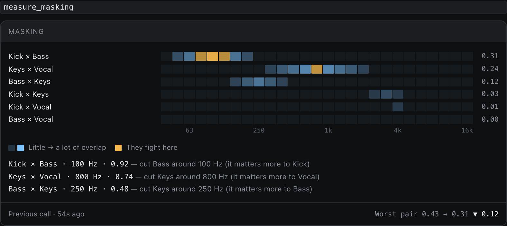

This is the main event. You describe a problem the way you'd tell an engineer, and `/mixer` does the legwork: it measures, makes the change with plugins you already own, then measures again to check it worked.

## You'll need

Your project open, and the section with the problem playing (a busy chorus beats a quiet intro).

## Say this

> say: /mixer The vocal gets buried in the chorus. Can you make it cut through without just turning it up?

Other things people ask: "I hear some low-end rumble", "the guitars sound muddy", "make the drums punchier".

## What happens

1. **A snapshot** of your mix before anything changes.
2. **It measures** the vocal and the instruments around it. A tool called masking checks which tracks are fighting for the same frequencies, and by how much.
3. **It makes small, specific moves**, like cutting the guitars a few dB around where the vocal lives, adding a touch of compression, or a gentle lift in presence. It uses plugins you own, and says which.
4. **It measures again** and tells you the before and after.
5. **A second snapshot**, so you can flip between before and after while you listen.

## Why it measures in "perceived" units

A raw level in dBFS isn't what your ear hears: a bass at -10 dB sounds quieter than a hi-hat at -10 dB. The assistant judges balance in units that follow how loud things *sound* (LU), which is why its answers can differ from a plain meter.

## If something's off

- **The change is too much.** "Halve that." It's a number, so it can.
- **It sounds worse.** Undo it, or restore the "before" snapshot, and tell it what you heard.
- **It used a plugin you don't like.** Name the one you'd rather use.

> your-call: It proposes a fix and shows the numbers. Whether the vocal now *sits* is something only you can hear.

::: details Transcript

The transcript is added here after the video is recorded.

:::
