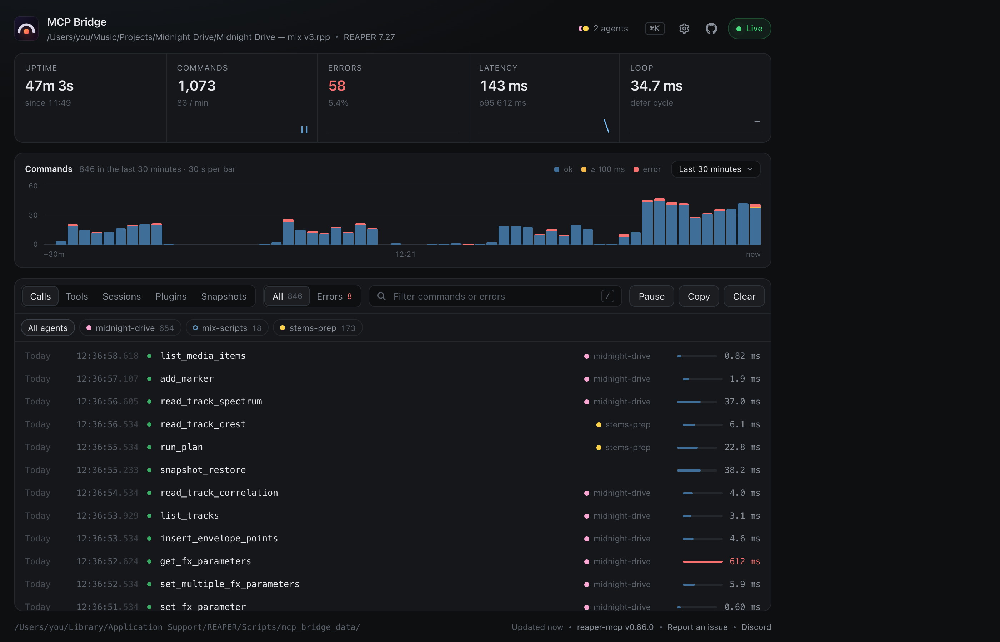
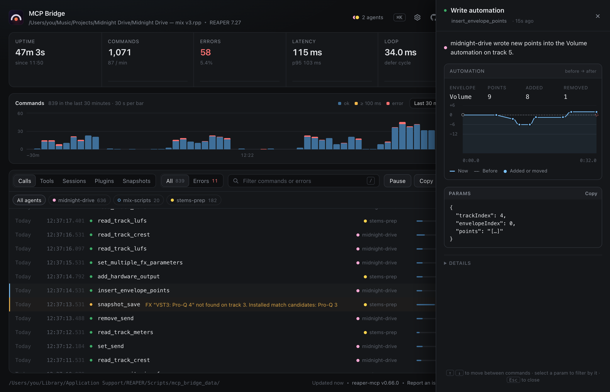

When the connector is running, a small window opens next to REAPER. Think of it as the assistant's receipt printer: every question it asks, every change it makes, in order.

## What's in it

- **Calls.** A list of everything it did, with how long each took and whether it worked. Click one for details.
- **Cards.** A change shows its before and after: a mixer, a plugin's knobs, notes on a piano roll, automation curves. A measurement shows what it read, like a spectrum or a loudness curve.
- **Snapshots.** Save your mix, or flip between saved ones to compare while you listen.
- **Plugins.** Which of your plugins the assistant knows about.
- **Settings.** Read-only mode, Pause, start with REAPER, and the usage statistics switch. See [safety](undo-and-safety.md).

## Try it without REAPER

The [live demo](https://reaper-mcp.vercel.app/) is the same window with pretend data, so you can click around before installing anything.

## Shortcuts

Press **Cmd/Ctrl+K** for the command palette, and **?** for the shortcut list.

## If it's not showing

Run `reaper-mcp doctor`, or see [Install](install.md#something-s-off).
