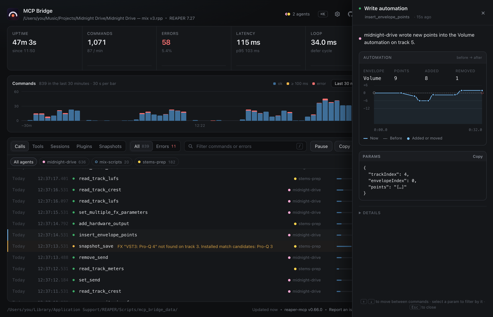

You're installed and REAPER is open with a project in it. Time to talk to it.

## Say this

> say: What's in my REAPER session? List the tracks and tell me which ones look too loud.

That's a read-only question. Nothing changes in your project, so it's a good first one.

## What happens

1. **It looks.** The assistant asks REAPER for your tracks, then reads their meters while you play a few seconds of the song. Press play if it asks.
2. **It reports.** You get the track list and a plain answer: "the guitars peak at -1 dB, the vocal is quiet".
3. **You can watch it work.** The status window next to REAPER logs every question it asked, with timing. Click a row and a card opens showing what was read, or what was changed and how it was before.

Prefer to look around without REAPER running? The [live demo](/) is the same window with pretend data.

## Then try a change

> say: /mixer Please gain stage my tracks

Gain staging means setting every track to a sensible starting level, so your plugins get a signal they like and nothing clips. The assistant saves a snapshot of your mix first, so you can go back.

> your-call: It will tell you its target and why. If it picked -18 dB and you like it hotter, say so. It will redo it.

## If something's off

- **"I can't see REAPER."** Check the status window shows a green light, then see [Something's off](install.md#something-s-off).
- **It's slow to answer.** Each question to REAPER takes a fraction of a second; the AI app's thinking time is the slow part.
- **You want it to stop.** The status window has a **Pause** button. See [Undo, snapshots and the pause button](undo-and-safety.md).
