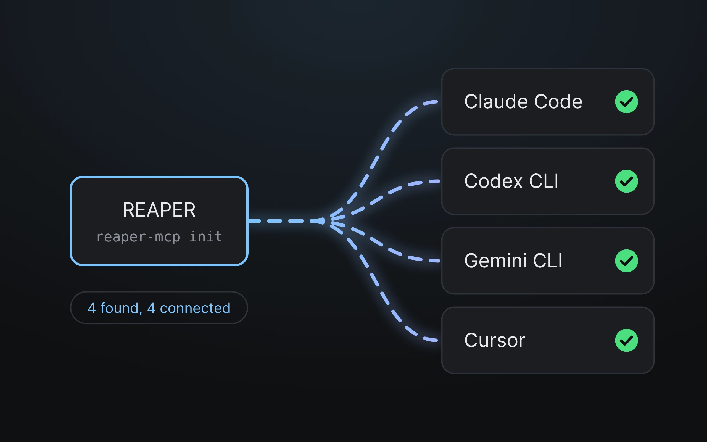

You'll paste three commands into a terminal, then start REAPER. That's it. No cloning, no building.

## Before you start

Have [REAPER, an AI app and Node.js](what-you-need.md) installed. If you only just installed Node.js, open a fresh terminal window afterwards.

## The three commands

Open a terminal (Terminal on Mac, PowerShell on Windows) and paste these one at a time:

```bash
npm install -g @mthines/reaper-mcp
reaper-mcp setup
reaper-mcp init
```

- `npm install` downloads reaper-mcp.
- `setup` puts the connector files into REAPER and opens a small status window next time REAPER starts.
- `init` finds the AI apps on your computer (Claude Code, Codex CLI, Gemini CLI, Cursor) and connects each one.

`setup` ends by offering to run `init` and a health check. Pressing Enter twice does both.



## Start REAPER

Start REAPER, or restart it if it was open. A small status window appears and shows a green light when the connector is running. If you'd rather not restart, run `mcp_bridge.lua` from REAPER's action list (**Actions → Show action list → Load ReaScript…**).

Then open your AI app in any folder and say hello:

> say: What's in my REAPER session?

## Prefer ReaPack?

::: details Install the REAPER side with ReaPack

In REAPER, go to **Extensions → ReaPack → Import repositories…** and paste:

```
https://github.com/mthines/reaper-mcp/releases/latest/download/index.xml
```

Then **Browse packages**, search for `reaper-mcp` and install the three packages (connector, meters, status page). ReaPack will offer updates like any other package.

You still run `npm install -g @mthines/reaper-mcp` and `reaper-mcp init` for the AI app side. Run `reaper-mcp setup` once too if you want the connector to start with REAPER.

:::

## Updating later

Run `reaper-mcp update`, or press **Update** in the status window inside REAPER. It does the same thing and then offers a **Reload** button. It won't restart anything on its own.

## Something's off?

Run `reaper-mcp doctor`. It checks each piece and says how to fix what's wrong.

- **The status window isn't showing a green light.** The connector isn't running. Run `mcp_bridge.lua` again from REAPER's action list.
- **Your AI app can't see REAPER.** Install the AI app first, then run `reaper-mcp init` again.
- **Missing skills** (the `/mixer` and `/critique` commands). Run `reaper-mcp install-skills`. It never overwrites files you edited.
- **Loudness, masking and stem tools don't work.** They need a small add-on: `reaper-mcp setup-sidecar` (needs Python 3.10 or newer).

More in the [FAQ](faq.md).
