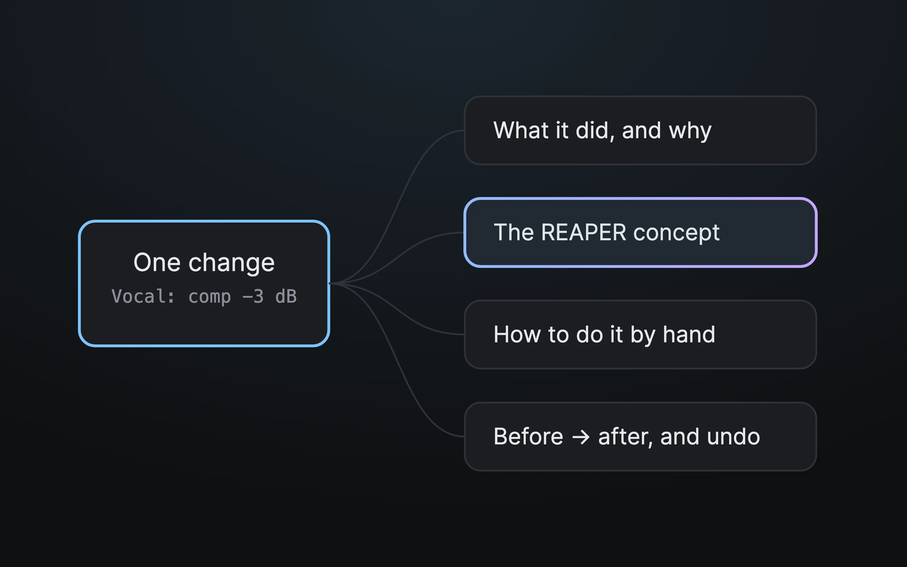

Type `/teach` and the assistant slows down and explains. Each change comes with what it's about to do and why, the REAPER idea behind it, how to do the same by hand, and the before and after.

It's for people who'd rather learn the move than just get the result.

## Say this

> say: /teach Balance my drums

Or ask a plain question: `/teach what is a send?`

## What you get on every change

- **What it did, and why.** Including whether that's measured fact or a rule of thumb.
- **The concept**, in plain words, linked to the [glossary](glossary.md).
- **How to do it by hand**, with your own keyboard shortcuts.
- **Before and after**, and the link to the change in the [status window](bridge-page.md).

> your-call: `/teach` is the slow, explaining version. When you've got the idea, use `/mixer` for the same job without the lecture.
