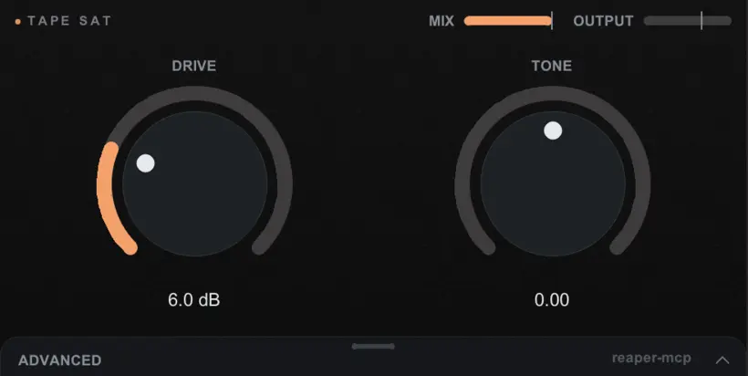
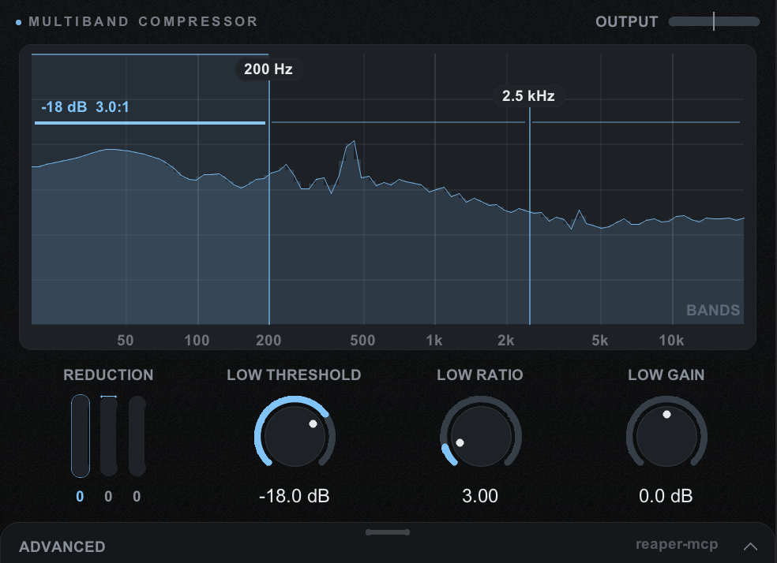
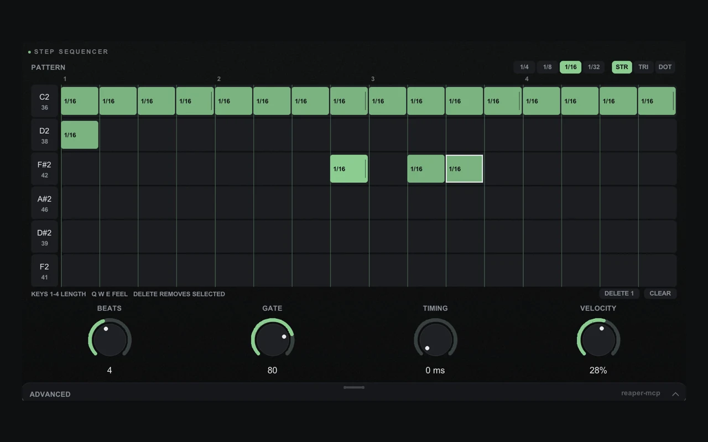

Ever wanted an effect that doesn't exist? "A trance gate", "keep my bass mono", "a multiband compressor where I can drag the bands on the spectrum". Describe it, and `/make-plugin` builds it.

## What you get

A normal REAPER plugin (written in JSFX, REAPER's own plugin language) with knobs and a small interface. Once it's made, it's just a plugin: it works with no assistant, no connector, no browser. You can keep it, share it, or ask for changes later.

## Seven to try first

Setup already put seven of these in REAPER, each with a few presets. They're the fastest way to see what a made plugin looks like. Open the FX browser, search for one by name (they end in "(reaper-mcp)"), and add it to a track.

::: gallery Already in your FX list
-  **Tape Sat**: warm tape saturation with a tone tilt. Try the "Warm bus" or "Old cassette" preset.
-  **Multiband Compressor**: three bands you drag on a live spectrum, each with its own threshold, ratio and gain.
- **Width / Bass Mono**: widens the stereo picture but keeps everything below the crossover in mono, so the low end stays tight.
- **Mutate Verb**: every hit gets an echo with a twist, a little pitch shift, sometimes reversed, sent into a reverb.
- **Drum Pads**: eight drum sounds you play with the mouse, the keyboard or a MIDI controller. No samples needed.
- **Pad MIDI**: eight pads that send MIDI notes. Put a sampler or drum plugin after it.
-  **Step Sequencer**: draw a drum loop on a grid and it plays in time with your project. Also needs a sampler after it.
:::

They're also good starting points. Ask for "one like Tape Sat, but only on the highs" and the assistant starts from that plugin instead of a blank page.

> say: Put Tape Sat on my drum bus and try the Warm bus preset

## Say this

> say: /make-plugin a step sequencer for my drums

Or: `/make-plugin a multiband compressor`, or `/make-plugin keep everything below 120 Hz in mono`.

## What happens

1. **It shrinks the idea** to the smallest plugin that does the job, so you get a handful of knobs rather than 40.
2. **It writes the plugin**, with the main controls in front and the extras under an **Advanced** drawer.
3. **It loads it on a scratch track** and checks it by measurement that it does what you asked.
4. **It fixes what the checks find**, a few rounds if needed.
5. **It hands it over**, loaded and ready.

## Changing it later

> say: /make-plugin update my step sequencer: add swing

Your saved presets and automation keep working, unless you agree to a breaking change.

## If something's off

- **It doesn't show up in your FX list.** A brand new plugin can need a rescan. Ask the assistant to add it by name.
- **It sounds nothing like what you meant.** Describe the sound, not the technique: "gritty like a tape machine, but only on the highs".

> your-call: It builds what you described. If it isn't *the sound*, that's a description problem as much as a code one, so keep iterating.

::: details Transcript

The transcript is added here after the video is recorded.

:::
