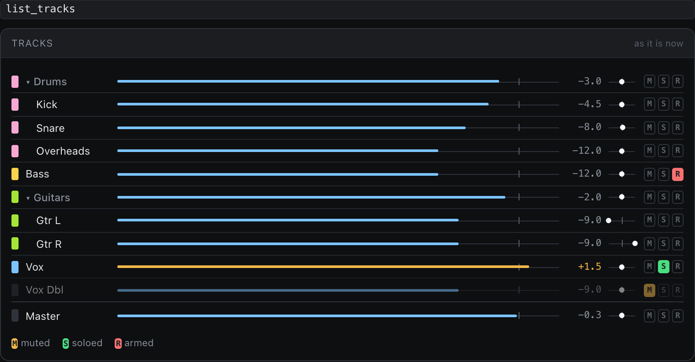

Every session starts with the same chores: drag in 40 files, rename them, color them, send the drums to the drum bus, bring the faders to something sane. You do it the same way every time, which is exactly why it's worth handing off.

This page shows the whole flow, then how to teach it *your* way of doing it so you only explain once.

## You'll need

- A folder of audio files (stems or tracks from a recording).
- A REAPER project or track template you like. Optional, but it's what makes the result yours.
- The [status window](bridge-page.md) open, so you can watch.

## Say this

> say: Prep a new session from the files in ~/Music/NewSong. Use my "Band template" project as the layout. Import each file onto its own track, name it from the file name, put drums, guitars and vocals in their folders, and set starting levels. Save a snapshot first and tell me what you did.

Swap in your own folder and template names.

## What happens

1. **A snapshot.** Before anything changes, so you can go back.
2. **Import.** Each file lands on its own track at the start of the song.
3. **Naming and color.** Tracks are named plainly, like "Kick" and "Lead Vocal", with no extra prefixes. The folder already says what group they're in.
4. **Routing.** Drums go to the drum folder, guitars to theirs, and so on, following your template.
5. **Starting levels.** While the song plays, it reads each track and brings it to a sensible starting level (about -18 dBFS average), so plugins get a signal they like.
6. **A report.** A list of what it did, with a card for each step in the status window.

## Teach it your steps once

If you always do it your way, say so once, and ask it to remember:

> say: Remember this for next time: I always put the click and guide tracks at the bottom, in grey, muted. Drums are red, bass orange, guitars green, vocals blue.

With [LoreKit](it-remembers.md) connected, the assistant can keep that as a lesson and read it at the start of the next job, so "prep this like last time" gets shorter. Without LoreKit it still follows your instructions within a conversation, but it won't carry them to the next one.

> your-call: It follows your layout, it doesn't invent one. If it guesses wrong about which file is which, correct it once ("that's the room mic, not the overhead") and it'll fix the rest.

## If something's off

- **It named things differently than you would.** Tell it the rule ("call the snare top 'SnT'") and ask it to redo the names.
- **It put a track in the wrong folder.** Say which one. It's one undo step either way.
- **It imported only some files.** Ask which ones it skipped and why. Unusual file formats are the usual reason.

::: details Transcript

The transcript is added here after the video is recorded.

:::

Next: [Get a second opinion on your mix](second-opinion.md).
