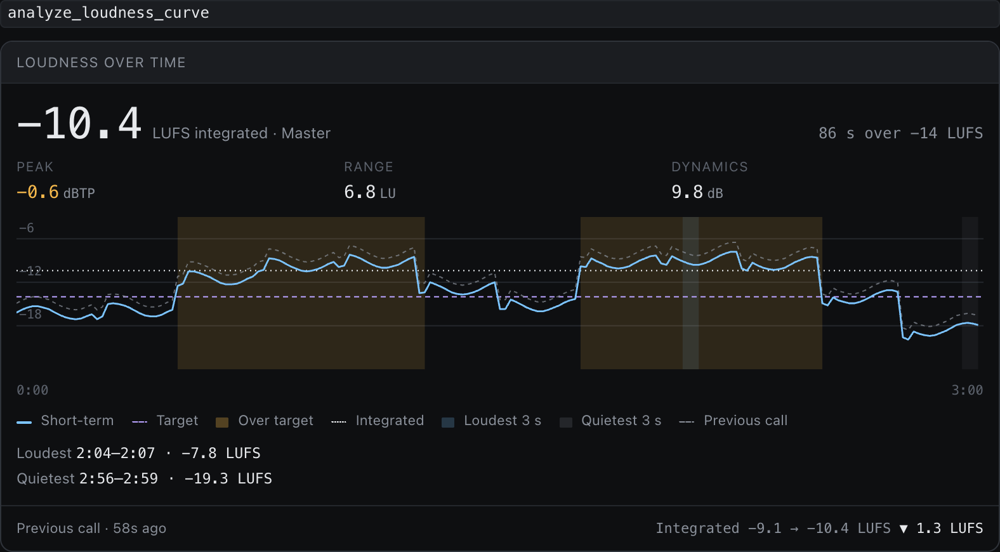

You've listened to the same mix 200 times and can't hear it any more. `/critique` is the friend who walks in with fresh ears and a spectrum analyzer. It's allowed to be a little blunt about it.

It never changes anything, so it's the safest thing to try first.

## You'll need

Your project open in REAPER, and a few seconds of the loudest section playing so the meters have something to read.

## Say this

> say: /critique Roast my mix. What could be better?

You can narrow it down: `/critique focus on the low end`.

## What happens

1. **It measures.** Loudness, frequency balance, stereo width and dynamics, track by track and on the master.
2. **It reports.** Each point comes with a reading: "the kick and bass overlap at 50-80 Hz", "the mix peaks at -0.2 dBFS with little headroom".
3. **It suggests, but doesn't touch.** You get a list of things to try, in order of what matters most.

## Reading the answer

- A claim with a number next to it was measured.
- A claim without one is the assistant's taste. Treat it as a starting point, and ask "how do you know?" if it matters.

> your-call: A critique is a to-do list, not a verdict. Pick the three things you agree with and ignore the rest.

When you want it to act on some of it, go to [balance a mix with real measurements](balance-a-mix.md).

::: details Transcript

The transcript is added here after the video is recorded.

:::
