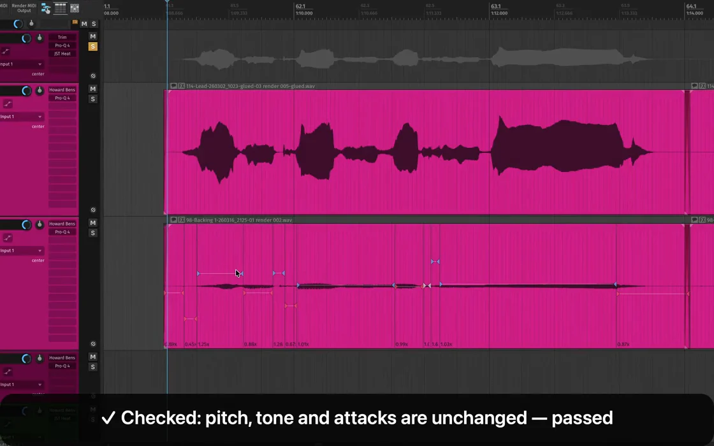

Doubles that drift against the lead sound loose in a way that's hard to name. Lining them up by hand means zooming in on every phrase. The assistant does the zooming.

## You'll need

A lead vocal take and one or more doubles or harmonies on their own tracks.

## Say this

> say: /editing Align the doubles to the lead vocal. Do a dry run first and show me how far each one moves.

## What happens

1. **It keeps your originals.** It copies the lead and each double to temporary tracks and edits those.
2. **It finds where each word starts**, in the lead and in every double, and pairs them up in order.
3. **A dry run.** You see the offset before and after for each double, in milliseconds, with nothing moved yet.
4. **It applies it**, with gentle stretching so the double lands on the lead.
5. **It checks the result** for clicks and damage against the original.

## What the checks can and can't say

They can tell you the edit didn't add a click, and that timing and pitch stayed within normal limits. They can't tell you it sounds *good*. Play the aligned section with the lead before you accept it.

Heavy slow-downs (below about 0.9x) can sound artificial. If you're stretching that far, treat it as a backing layer, not a lead.

> your-call: Perfectly tight isn't always right. Say "80% of the way" and it'll leave some of the human wobble in.

::: details Transcript

The transcript is added here after the video is recorded.

:::
