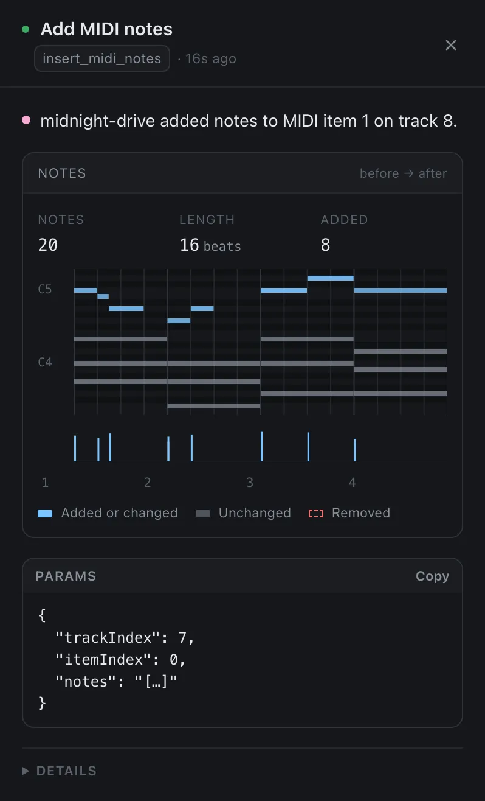
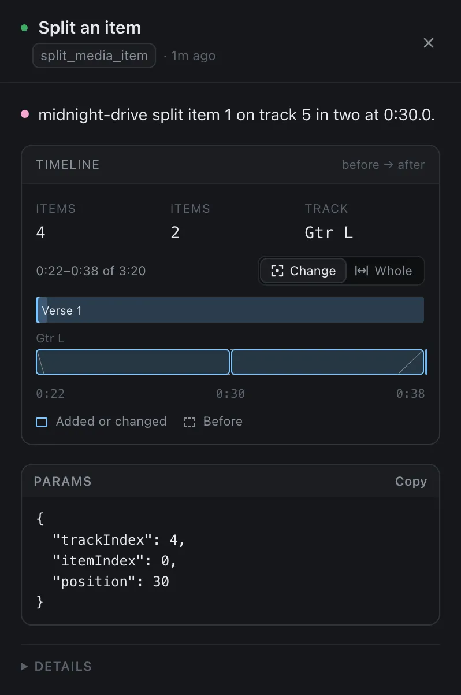
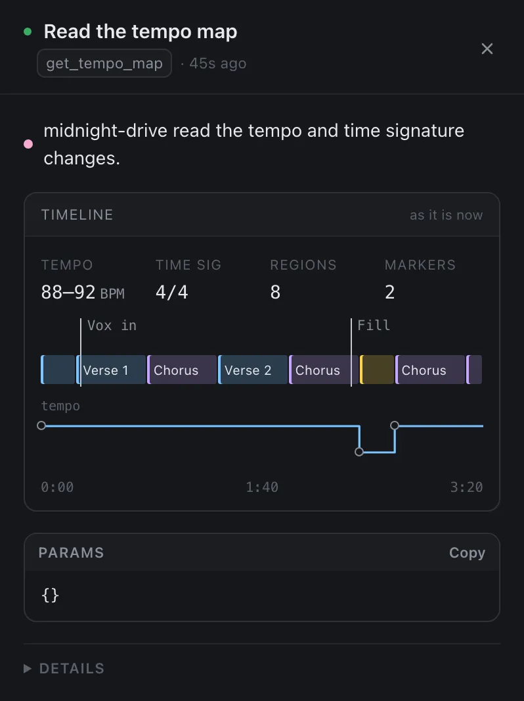
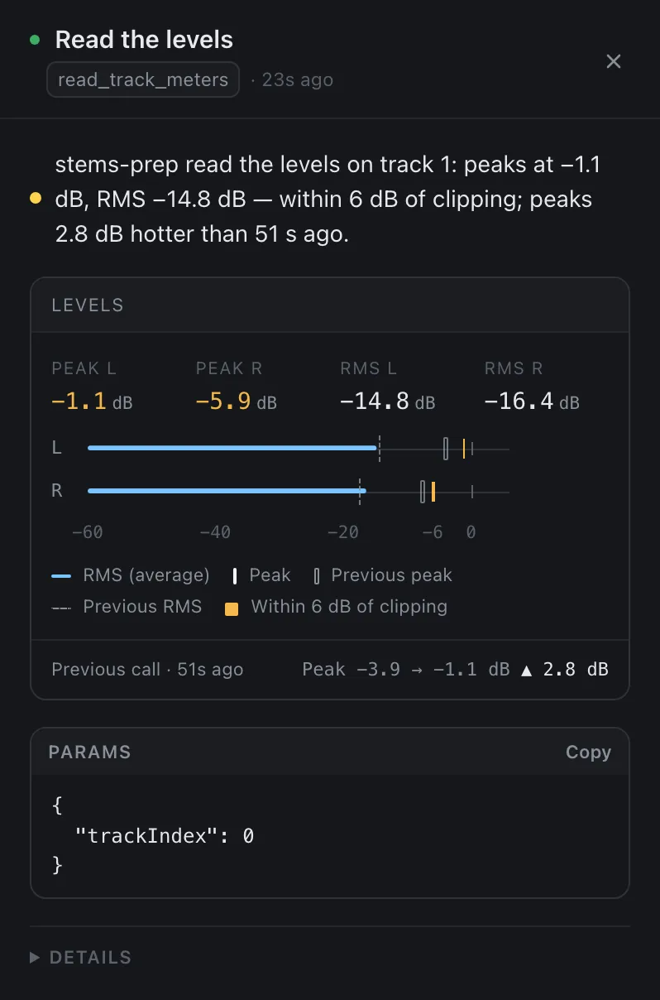
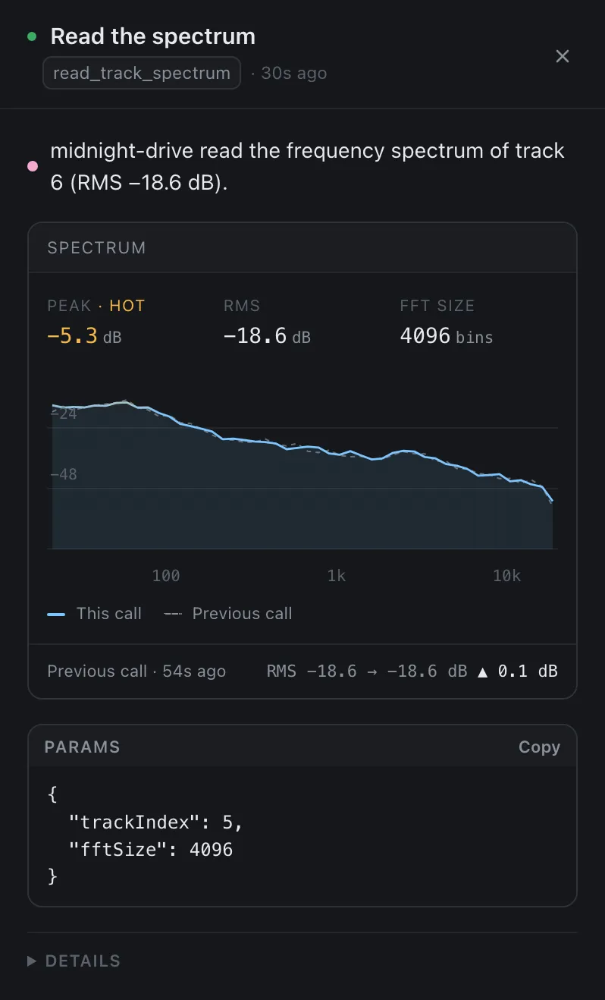
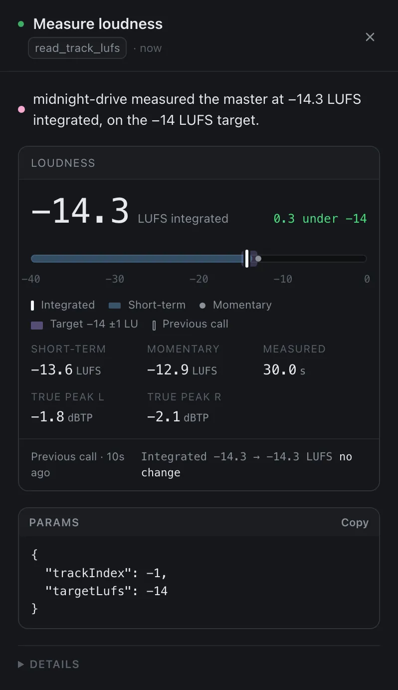
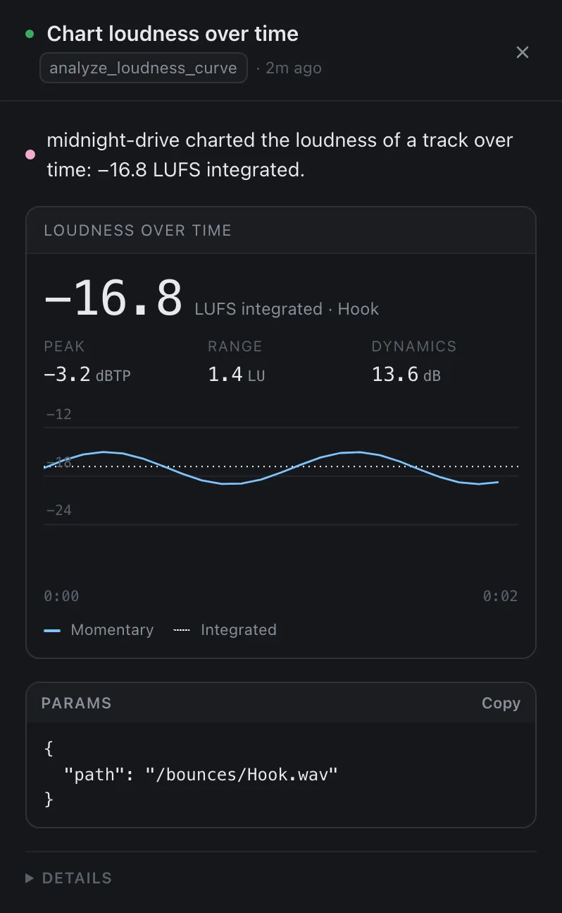
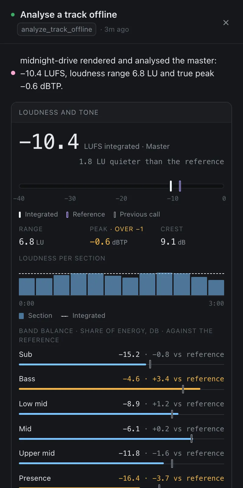

There are close to 190 tools behind the assistant, but you never pick one. You say what you want and it chooses. This page shows what's on the menu, so you know what to ask for, and what the status window draws when it does.

## What it can do

- **Tracks and plugins.** Add, name, colour, group and route tracks. Add plugins and set their parameters, copy a chain from one track to another, save chains and templates.
- **MIDI and editing.** Write, quantize and humanize notes. Split, move, trim and stretch audio. Copy a verse to the second chorus, open or close time across the whole project.
- **Automation.** Draw volume, pan and plugin envelopes, or build reusable automation items for section levels.
- **Listening.** Peak, loudness, spectrum, stereo width, masking between tracks, key and chords. It measures before and after, so "better" comes with a number.
- **Recording and finishing.** Arm tracks, set punch ranges, comp takes, render stems or a master.
- **Keeping track.** Snapshots you can flip between, plus markers, regions and tempo changes.

The full list, one line per tool, is in the [tool reference](https://github.com/mthines/reaper-mcp/blob/main/docs/TOOLS.md). A few tools need the audio add-on (Python): loudness curves, masking, stems. [Install](install.md) covers it.

## What it looks like

Every call the assistant makes shows up in the [status window](bridge-page.md) with a drawing of what changed. Here are some of them, as the demo shows them.

::: gallery What each kind of call draws
-  **A plan of edits**: several steps in one go, one undo. A dry run lists them and writes nothing.
-  **Plugin chains**: each slot marked added, moved or changed.
-  **Routing**: sends, receives and outputs as wires, thicker for louder.
-  **Sidechain pins**: which track channels feed which plugin inputs.
-  **MIDI notes**: a piano roll, new notes in blue, removed ones dashed.
-  **Audio quantize**: the hits before and after, and how far off the grid you were.
-  **Item edits**: a lane per track, the items before dashed.
-  **Arrangement**: what was copied, where it went, and the automation that came along.
-  **Markers and regions**: the song's shape on one timeline.
-  **Tempo**: every tempo and time signature change.
-  **Automation curves**: the window the edit touched, before and after.
-  **Automation items**: blocks tinted by pool, so shared curves are obvious.
-  **Levels**: peak and RMS, with a warning near clipping.
-  **Spectrum**: the balance, band by band.
-  **Loudness**: LUFS against your target, with the last reading ghosted.
-  **Loudness curve**: where the song runs over target.
-  **Masking**: where two tracks fight, and which one should give.
-  **Offline analysis**: the whole song's numbers, no playback needed.
-  **Comping**: which part of the comp came from which take.
-  **Renders**: each file's length, loudness and peak.
:::

## It can run almost any REAPER action

REAPER has about 6,000 actions: everything in the Actions list, the SWS extension, your own scripts, and the custom macros you've built. The assistant can search that list and run what it finds:

- **`search_actions`** finds actions by name ("normalize", "glue", "dynamic split").
- **`get_action`** shows one in detail, including the steps of one of your macros.
- **`run_action`** runs it.

So when there's no dedicated tool for something, it isn't a dead end. If REAPER can do it from a menu or a shortcut, the assistant can usually do it too, including the things you scripted yourself.

> say: Find the action that does dynamic split, then run it on the selected drum item

> say: Run my "Prep for mixing" macro

A few things worth knowing:

- **Actions work on what's selected.** It selects the tracks or items first, then runs the action.
- **Your own actions have a stable name.** Their numbers change from session to session, so it remembers the named ID instead.
- **Anything that opens a dialog is refused**, because a dialog would freeze REAPER until someone clicked it. Quit, close project, open project and tab switching are always refused. It's one undo step, like everything else. See [undo and safety](undo-and-safety.md).
- **Some places have no way in.** The inline MIDI editor and the Media Explorer can't be driven by actions.

> your-call: If you'd normally reach for a menu, ask for it in words first. The assistant finds the action; you decide whether the result stays.
