There are close to 190 tools behind the assistant, but you never pick one. You say what you want and it chooses. This page shows what's on the menu, so you know what to ask for, and what the status window draws when it does.

## What it can do

- **Mix and measure.** Gain staging, EQ and compression with your own plugins, balance judged in perceived loudness, masking between tracks, stereo width, a whole-song loudness curve. It measures before and after, so "better" comes with a number, and it can [critique your mix](second-opinion.md) without touching it.
- **Finish.** Master to a loudness target, render stems or a master, or several versions in one go (full, instrumental, TV), each checked for loudness and true peak.
- **Write and sketch music.** [Hum a melody](sketch-a-song.md) and get a band arrangement. Write, quantize and humanize MIDI, find the key and chords of a song, import a `.mid` file.
- **Edit audio and MIDI.** Split, move, trim and stretch items. [Line up vocal doubles](vocal-doubles.md), comp takes, quantize audio hits to the grid, copy a verse to the second chorus, open or close time across the whole project, split a mix into stems.
- **Automate.** Volume, pan and plugin envelopes, reusable [section levels](section-levels.md), and a [light show](light-show.md) drawn from the hits in a song.
- **Build plugins.** [Describe an effect](make-a-plugin.md) and get a real REAPER plugin with its own knobs. [Teach it the plugins you own](teach-it-a-plugin.md), and it remembers.
- **Tracks and sessions.** Add, name, colour, group and route tracks, [prep a session](prep-from-template.md) from your template, arm and punch in, keep snapshots you can flip between, plus markers, regions and tempo changes.

The full list, one line per tool, is in the [tool reference](https://github.com/mthines/reaper-mcp/blob/main/docs/TOOLS.md). A few tools need the audio add-on (Python): loudness curves, masking, stems, hit detection. [Install](install.md) covers it.

## What it looks like

Every call the assistant makes shows up in the [status window](bridge-page.md) with a drawing of what changed. Here are some of them, as the demo shows them.

::: gallery What each kind of call draws
- 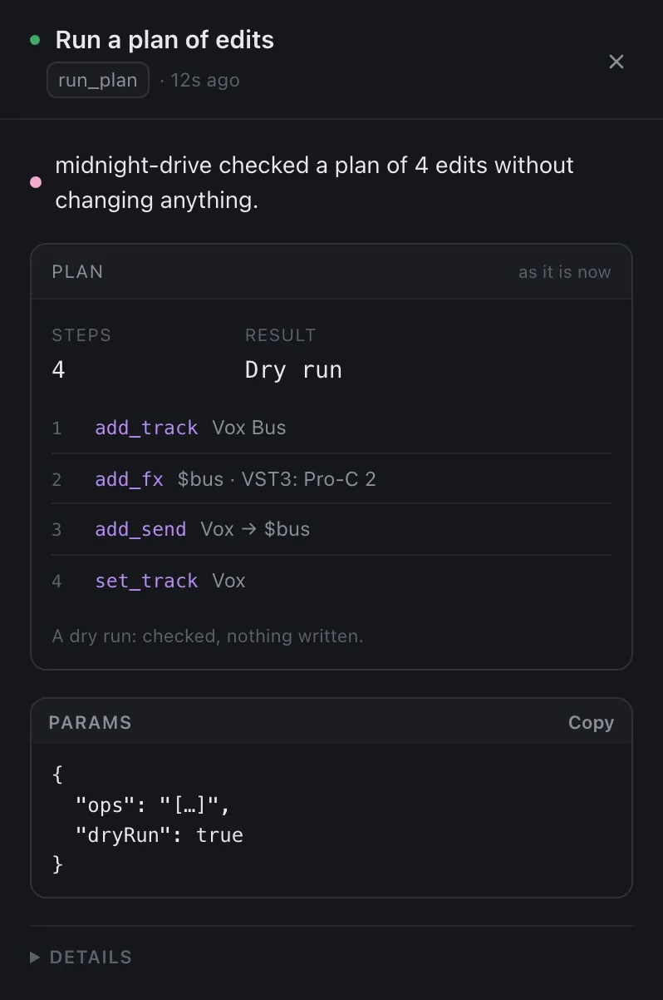 **A plan of edits**: several steps, one undo. A dry run writes nothing.
- 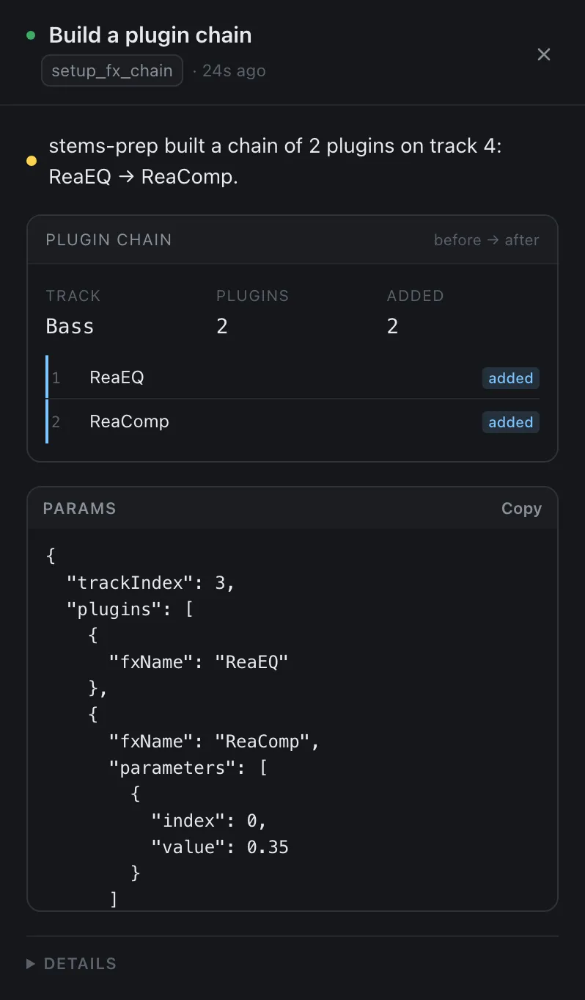 **Plugin chains**: each slot marked added, moved or changed.
- 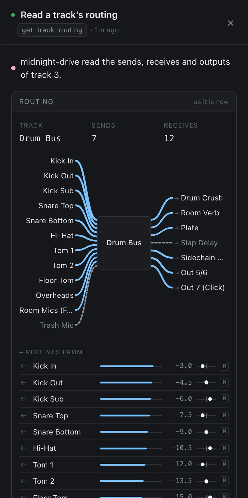 **Routing**: sends, receives and outputs as wires, thicker for louder.
- 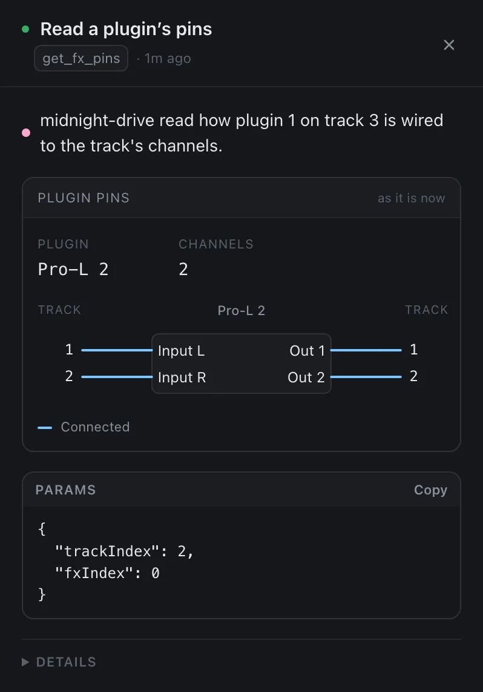 **Sidechain pins**: which track channels feed which plugin inputs.
-  **MIDI notes**: a piano roll, new notes in blue.
- 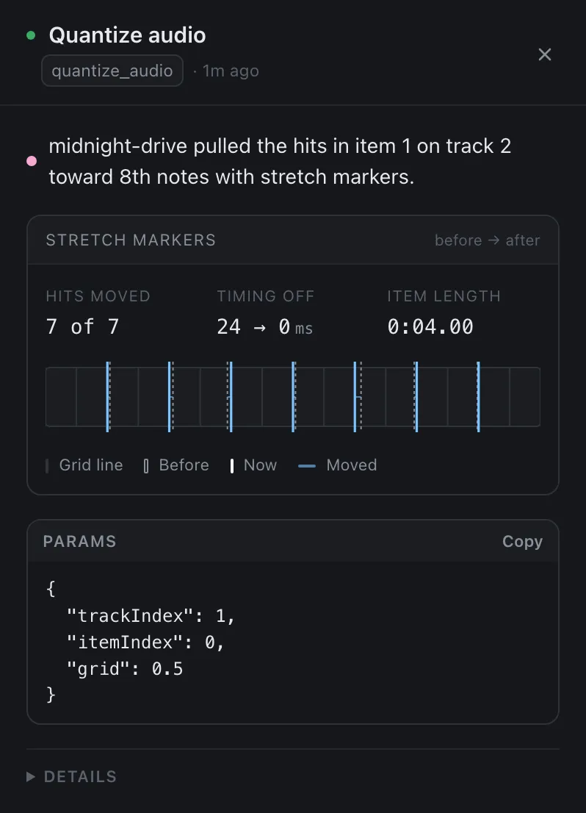 **Audio quantize**: hits before and after.
-  **Item edits**: a lane per track, the items before dashed.
- 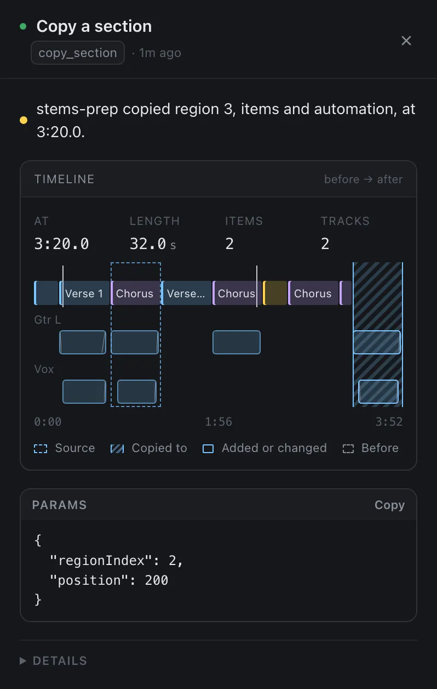 **Arrangement**: what was copied, and where it went.
- 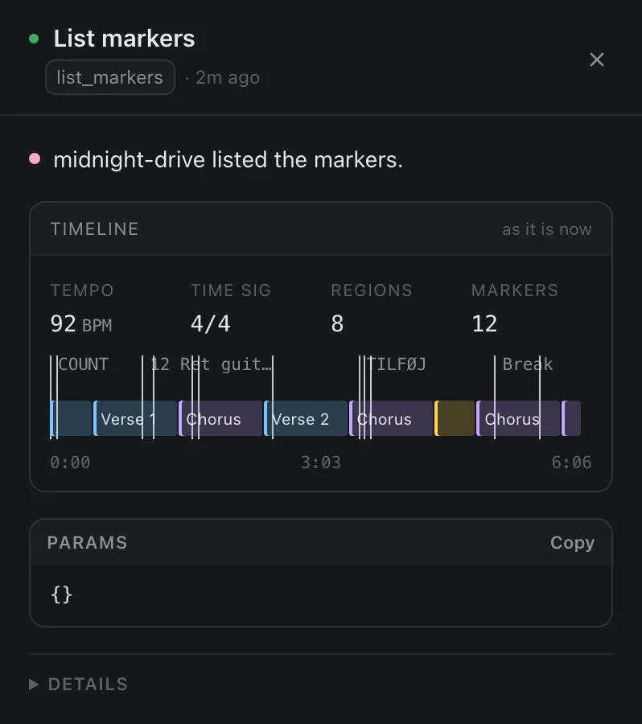 **Markers and regions**: the song's shape on one timeline.
-  **Tempo**: every tempo and time signature change.
- 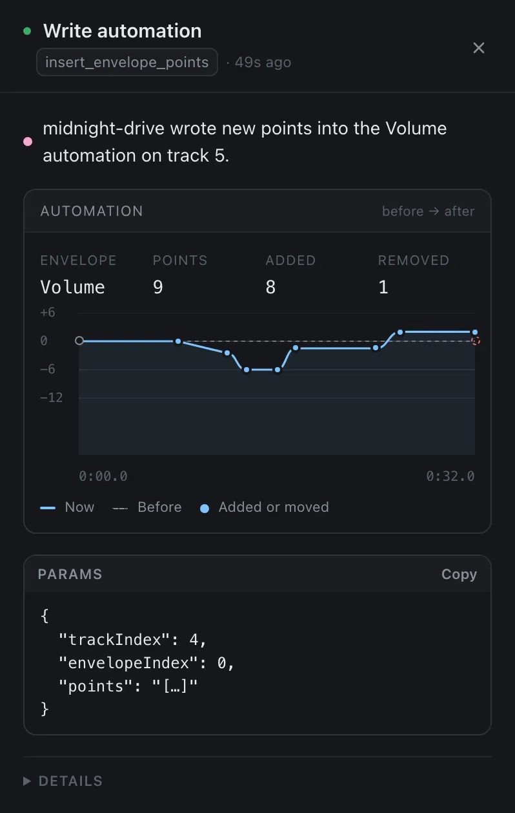 **Automation curves**: before and after.
- 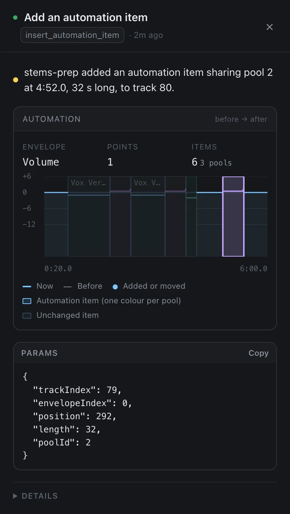 **Automation items**: blocks tinted by shared pool.
-  **Levels**: peak and RMS, with a warning near clipping.
-  **Spectrum**: the balance, band by band.
-  **Loudness**: LUFS against your target.
-  **Loudness curve**: where the song runs over target.
- 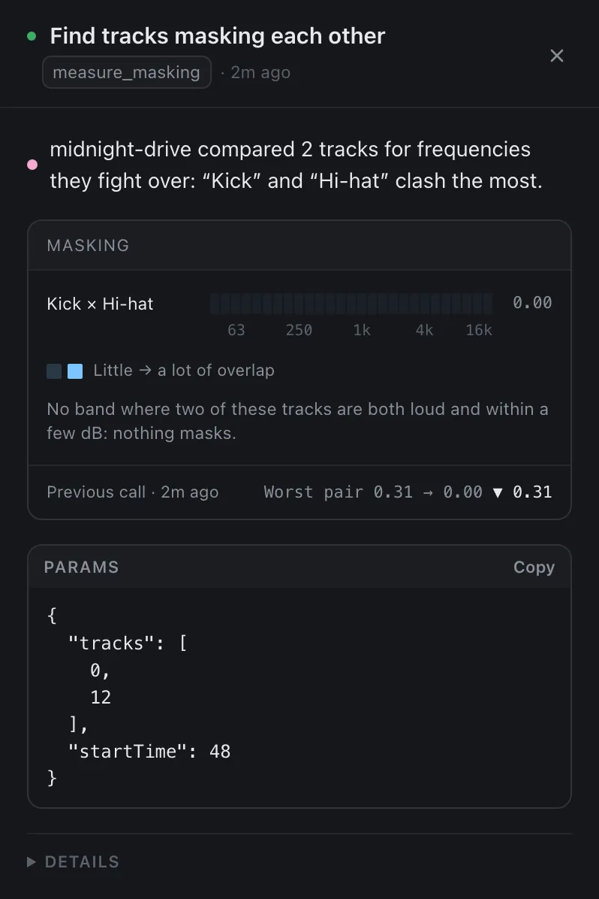 **Masking**: where two tracks fight.
-  **Offline analysis**: the whole song, no playback.
- 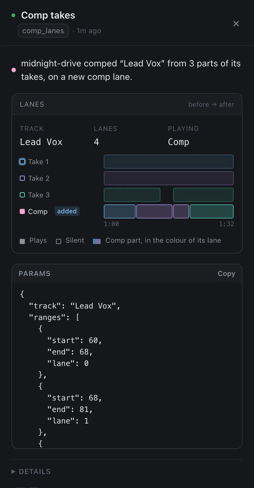 **Comping**: which part came from which take.
- 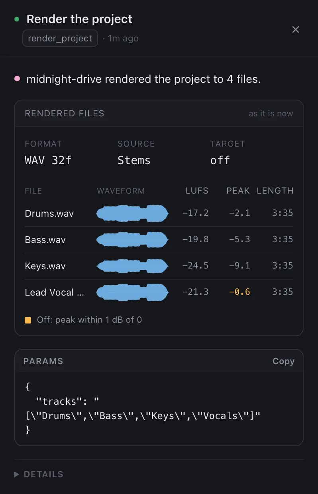 **Renders**: loudness and peak per file.
:::

## It can run almost any REAPER action

REAPER has about 6,000 actions: everything in the Actions list, the SWS extension, your own scripts, and the custom macros you've built. The assistant can search that list and run what it finds:

- **`search_actions`** finds actions by name ("normalize", "glue", "dynamic split").
- **`get_action`** shows one in detail, including the steps of one of your macros.
- **`run_action`** runs it.

So when there's no dedicated tool for something, it isn't a dead end. If REAPER can do it from a menu or a shortcut, the assistant can usually do it too, including the things you scripted yourself.

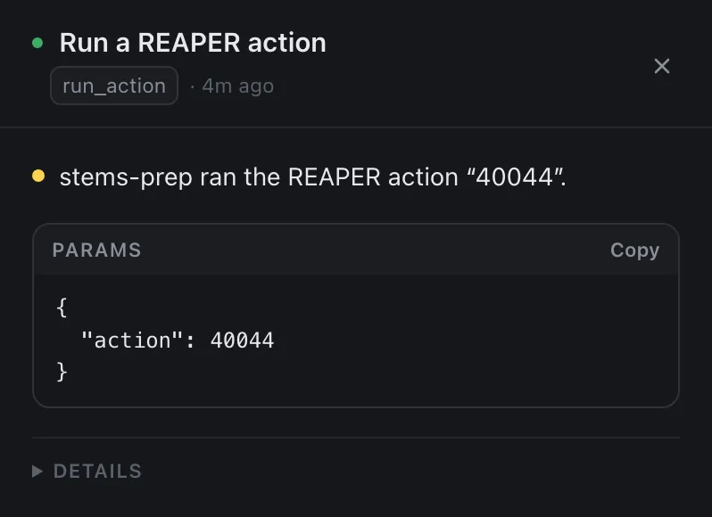

> say: Find the action that does dynamic split, then run it on the selected drum item

> say: Run my "Prep for mixing" macro

A few things worth knowing:

- **Actions work on what's selected.** It selects the tracks or items first.
- **Your own actions have a stable name**, so it remembers the named ID, not the session's number.
- **Anything that opens a dialog is refused** unless you've said it's fine, because a dialog freezes REAPER until someone clicks it. Quit, close project, open project and tab switching are always refused. It's one undo step, like everything else. See [undo and safety](undo-and-safety.md).
- **The inline MIDI editor and Media Explorer** can't be driven by actions.

> your-call: If you'd normally reach for a menu, ask for it in words first. The assistant finds the action; you decide whether the result stays.
