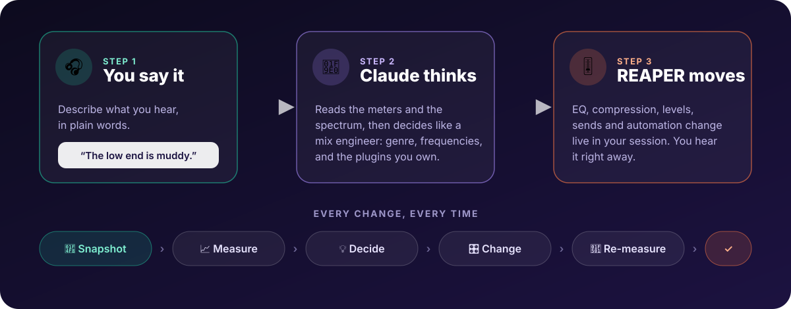

reaper-mcp connects an AI assistant to your open REAPER session. You say what you want in plain words and it does it, in the project in front of you: naming and routing tracks, setting levels, editing audio and MIDI, drawing automation, building plugins. Then it tells you what it did and measures the result.

It isn't a separate app or a plugin to learn. It's a second pair of hands for the whole of REAPER, and anything it does is one undo away.

## What sets it apart

- **It measures, then changes, then measures again.** Loudness, spectrum, stereo width, masking between tracks, key and chords. "It sounds better" comes with a number, and it can analyze a whole song offline without pressing play.
- **It reaches all of REAPER.** Close to 190 tools for tracks, plugins, MIDI, items, automation, tempo, recording and rendering, plus the ability to run almost any of REAPER's 6,000 actions, including your own scripts and macros.
- **It makes things.** Hum a melody and get a band arrangement. Describe an effect and get a real plugin with knobs that keeps working without the assistant. Turn the hits in a song into light-show automation.
- **It works with the plugins you own.** It learns how each one behaves, tests it live, and remembers for next time. Your own plugin notes sit on top of a shared library of built-in ones.
- **It never works without a net.** Every change is one undo step, snapshots let you flip between versions, and a pause button stops it cold. A status window shows every move with before and after.
- **It's free and open source**, and it runs in the AI app you may already use: Claude Code, Codex CLI, Gemini CLI or Cursor.

[See what it can do](what-it-can-do.md) for the whole range, with pictures of what each kind of change looks like.

## What it doesn't do

- **It doesn't hear for you.** It measures loudness, spectrum and stereo width. Whether the chorus *feels* big is still a job for your ears.
- **It isn't in charge.** It proposes and does the legwork. A sketch, an arrangement or a mix move is a starting point you keep, change or throw away.
- **It doesn't replace your plugins or your taste.** It uses what you have, and when a choice is taste it says so.

> your-call: The assistant suggests and does the legwork. Taste, direction and "yeah, that's the sound" stay with you.

## Where to go next

New here? [What you need](what-you-need.md) lists the few things to download, then [Install](install.md) takes about five minutes. Already installed? Try [your first conversation](first-conversation.md).
