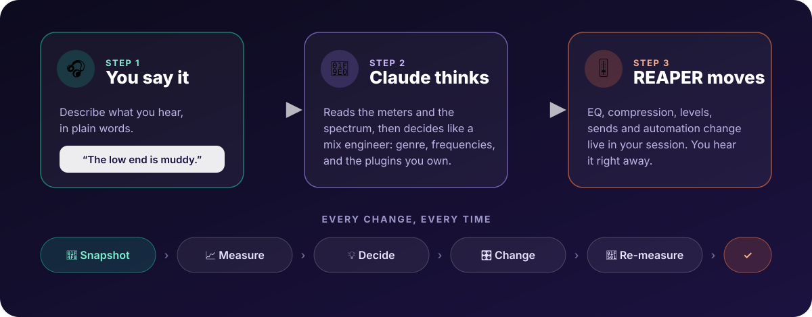

reaper-mcp connects an AI assistant to your open REAPER session. You type what you want, in plain words, and it does the clicking: naming tracks, setting levels, adding plugins you already own, checking meters. Then it tells you what it did.

Think of it as an assistant engineer who sits next to you, has read the manual, and never gets bored of gain staging.

## What it's good at

- **The tedious, measurable stuff.** Naming 40 tracks, routing them to buses, setting starting levels, finding the two instruments fighting over the same frequencies.
- **Checking its own work.** It reads the meters before it touches anything and again afterwards, so "it sounds better" comes with a number next to it.
- **Explaining.** Ask why it made a move and you get an answer, not a shrug. Ask it to go the other way and it will.

## What it isn't

- **It isn't a composer.** It won't write your chorus. If you ask for one it will try, but that isn't what it's for.
- **It can't hear your song.** It measures loudness, spectrum and stereo width. Whether the chorus *feels* big is still a job for your ears.
- **It isn't in charge.** Every change is one step you can undo, and it works with the plugins you already have. You decide what stays.

> your-call: The assistant suggests and does the legwork. Taste, direction and "yeah, that's the sound" stay with you.

## Where to go next

New here? [What you need](what-you-need.md) lists the few things to download, then [Install](install.md) takes about five minutes. Already installed? Try [your first conversation](first-conversation.md).
